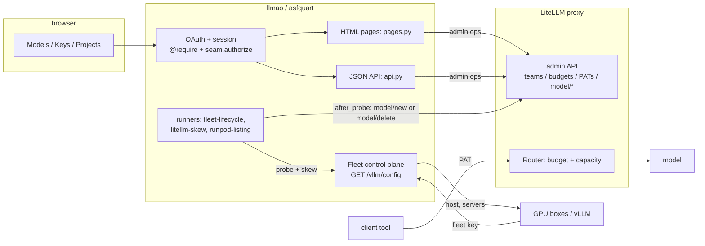
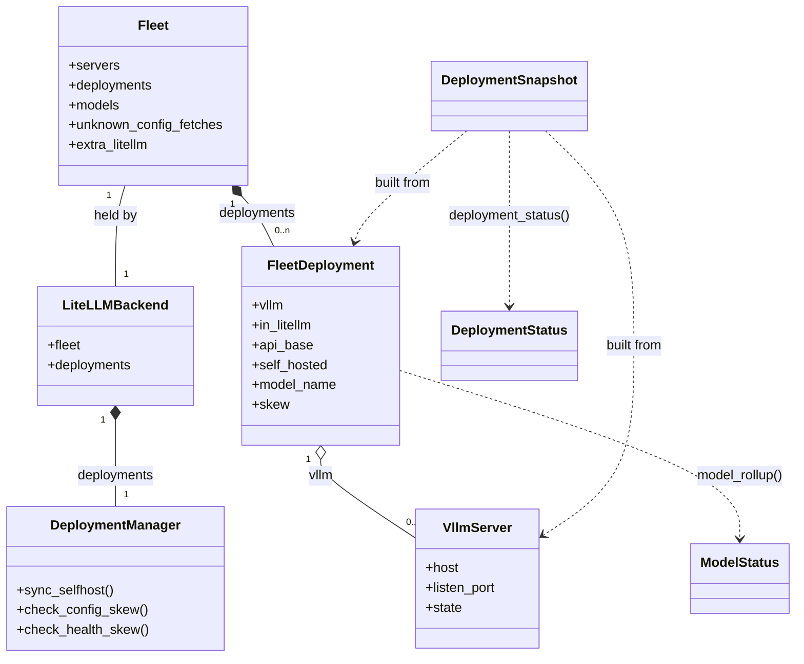

# Architecture (implementation)

This document describes **how this repository is structured**. Product intent,
credential rules, ownership, and non-goals live in the **master design**:

- **Committers:** `apache/rai-private` → `services/llmao/README.md`

This app is the **asfquart / Tooling half** of the gateway: identity, project
vocabulary, PAT UX, and (planned) project envelope UX. **LiteLLM** is the
inference pipe and meter. Completions are **not** re-proxied through this process.
Product concepts: rai-private design; planned UI work: `docs/STATUS.md`.

## Always asfquart

There is no “dev auth mode.” The process is always constructed with
`asfquart.construct("llmao", …)` in root `main.py` (same idea as Apache
STeVe’s `server/main.py`). HTML lives in `pages.py`, JSON API in `api.py`,
both bind to `asfquart.APP` after construct. Standalone: `python main.py`
(`runx` + optional TLS). ASGI: `hypercorn main:llmao_app` (`run_asgi`).

- OAuth at `/auth` (oauth.apache.org)
- Session cookies (`SESSION_COOKIE_SECURE=True` → use HTTPS locally)
- Optional `token_handler` for bearer tokens against *this* app (stub today)
- `@asfquart.auth.require` / `Requirements` on protected routes; project-scoped
  rules stay in `seam.py`

Local TLS: `config.yaml` `server.certfile` / `keyfile` under `certs/`, typically
mkcert for **`localhost.apache.org`**. `config.yaml` is gitignored (secrets).
Loaded as **`APP.cfg`** (EasyDict); use dotted access (`APP.cfg.litellm.base_url`).

## The two halves

**asfquart** handles *who you are and what you're allowed to do* at the
Foundation level. LDAP-backed `ClientSession` carries `uid`, committer
`projects`, and PMC `committees` (`pmcs`).

**LiteLLM proxy** holds *teams, users, virtual keys (PATs), budgets, capacity
limits, and spend*. Clients call its OpenAI-compatible API with a PAT. This
process talks to LiteLLM over the **admin** surface (master key, **async
httpx**) to provision teams and mint or revoke virtual keys—see design
§5–6. Project names are LDAP/session names (asfquart); no rename map.

**Model definitions** are `models.yaml` (llmao UX + vLLM recipe + `/model/new`
template). LiteLLM does **not** include it. `store_model_in_db: true` in
`litellm.yaml` `general_settings` (Puppet may also set the env). Deployments
are pushed by llmao. Self-host prefix is `hosted_vllm/`.
A model carries a vLLM recipe if we can run it ourselves, and says nothing
about where it is served: that is each deployment's. Our boxes come from
`fleet.hosts`; providers we pay (xAI, OpenRouter) from `config.yaml`
`providers`, each listing the models it serves and holding its own key. One
model can be served several ways at once; LiteLLM's `order` puts our boxes
first and a provider only behind them. Governance fields live under
`model_info`. Standalone asfquart watches `config.yaml` (`runx` extra_files);
production Puppet restarts the service after a change.

**LiteLLM virtual keys / teams** need Postgres + Prisma (`litellm[proxy,extra-proxy]`).
Developers: system PostgreSQL + `make db`. Production: Puppet + on-disk
`database_url`.

**LLMAO's own records** live in LiteLLM's memory store (`/v1/memory`), since
LLMAO has no database: one row per access request (`llmao:request:<id>`) and
one for the tier limits an admin has changed (`llmao:tiers`). Per-project
token caps are still team metadata.

**PATs:** personal keys bind ASF uid + project team + purpose; automation
keys are team-scoped exceptions (who may create them is an **open RAI
policy** question — see design + `docs/STATUS.md`). Secrets shown once;
metadata in LiteLLM.

**GPU fleet (control plane).** The box side is `docs/box-protocol.md`; the
state machine is `docs/box-lifecycle.md`. `APP.fleet` (`llmao/fleet.py`) is
built at startup.

- `GET /vllm/config` (Bearer `fleet.key`) maps `X-LLMAO-Host` to a
  `fleet.hosts` row, else the leftmost `X-Forwarded-For`, else the peer.
  The header is whatever the provider's `provision.sh` sets: Vast's
  `PUBLIC_IPADDR`, RunPod's pod id.
- The JSON is `{host, servers[]}`. `servers[].port` is the **container
  listen** port, never the public port. Both providers' listings supply the
  public port; it is never sent to the box.
- Three runners (`app.add_runner`):
  - `fleet-lifecycle`: reads the Vast listing, places servers on their
    boxes, probes `/health`, then calls `Fleet.after_probe`, which is
    `DeploymentManager.sync_selfhost`: `/model/new` for a Healthy server,
    `/model/delete` for a down one.
  - `litellm-skew`: reads the LiteLLM deployments and LiteLLM's own
    `/health`, prunes orphans.
  - `runpod-listing`: reads the RunPod pod list every 10 minutes.
- `Fleet.models` is the YAML recipe. `FleetDeployment` is one intended
  LiteLLM deployment. `VllmServer` carries the lifecycle state: Awaiting,
  Loading, Healthy, Unhealthy, Stalled, Rejected or Foreign.
- The `/models` admin drill-down shows the green badge only when the server
  is Healthy **and** LiteLLM has its deployment. host:port is site-admin.
- JSON handlers use `@api` in `api.py`. Do not wrap Quart `asgi_app` with
  Werkzeug ProxyFix.

**GPU boxes are not this process.** Vast: custom template,
`PROVISIONING_SCRIPT` → `provision.sh` → curl `install_set.py` (stock
container). RunPod: our own image, built by CI from `hosting/runpod/`, with
`provision.sh` as the entrypoint; the installer is still fetched at boot.
Detail: [`hosting/README.md`](../hosting/README.md). Runbooks:
[`hosting/vast/README.md`](../hosting/vast/README.md);
[`hosting/runpod/README.md`](../hosting/runpod/README.md).

Build status and backlog: **`docs/STATUS.md`**.

The app **always** uses **LiteLLMBackend** against a real LiteLLM admin API.
Offline **MockBackend** lives under `tests/` and is injected only by unit
tests—not a second runtime mode.

**Team ids:** in-process cache `project (team_alias) → team_id` only (immutable
under our rules). Warmed at startup (`before_serving` + `warm()`, fail-fast if
LiteLLM is down). Spend/budget always from live `team/info` when the id is
known; after a cache-miss `team/list`, use list-row fields (no redundant
`team/info`). No on-disk state store.

## The seam

`seam.py`:

1. **authorizes** project membership / PMC admin after asfquart has authenticated;
2. **delegates** project-scoped team/key ops to the backend (product API speaks project).

## Request path (this process)

```
browser → HTTPS (local mkcert or prod proxy)
       → asfquart OAuth / session
       → @require + seam.authorize
       → LiteLLM admin API (team/budget/PATs; deployments)
```

HTML mutations are `POST /do-*` only, then **303** to a GET display (flash for status; created-key secret is a `raw` HTML flash). JSON API is separate.

## Inference path (LiteLLM)

```
client tool → LiteLLM + PAT → budget / capacity → model
```

See `../README.md` for quickstart and API surface.

## Models and deployments

The vocabulary the `/models` page and the fleet code share. (Folded in from
the retired models-dashboard design, whose two passes shipped as
`llmao/model_status.py` and the combined Models page.)

- A **model** is what a user calls by the `model` parameter (`qwen3-8b`).
  A **deployment** is one place it is served: a vLLM server on a box we
  rent, or a commercial provider's endpoint. One model may have several
  deployments at once; LiteLLM's `order` puts our boxes first.
- **Self-hosted** means we control the virtual machine, not that we own the
  hardware (the ASF owns none). A rented Vast or RunPod VM running our vLLM
  is self-hosted.
- **Privacy** is a first-class, user-facing field. It answers "will my
  prompt leave the LLMs we control?"
  - **Private**: served only by vLLM on VMs we control.
  - **External**: sent to a third-party provider.
  - **Mixed**: the model has both kinds of deployment, or a LiteLLM
    deployment that config does not list. Mixed is the least private tier,
    so a Private badge is never shown for a model that could route
    externally.
  - The wording must not overclaim: a GPU host operator can in principle
    observe a rented VM's memory.
  - The LiteLLM-to-box hop is plain HTTP on the provider's public port,
    authenticated by the per-box bearer. It is not TLS.
- **What users see** per model:
  - Available, Degraded or Unavailable (the roll-up in
    `docs/box-lifecycle.md`).
  - Labeled capability chips.
  - The context window as the **minimum** across healthy deployments.
  - Concurrency as "up to N full-context requests": KV cache tokens divided
    by the window, summed over healthy self-hosted deployments. An upper
    bound.
  - Never an Awaiting, Loading or Stalled deployment. A box's pre-states
    must not make a working model look broken.
- **What admins see** in addition: the attention strip (unknown boxes,
  Stalled, Unhealthy, Rejected, Foreign, unlisted, skew), a replica summary
  per model, and the deployments drill-down with one primary action and a
  menu. Admin labels are shown, never counted.
- **Single source of intent:** `fleet.hosts` plus in-memory approvals say
  what should run; servers and LiteLLM deployments are derived from it. A
  deployment config intends but LiteLLM lacks is a visible skew badge, not
  a mystery.

## Components

Two request paths cross this process. The **HTML/UX** path (browser) goes through
asfquart and talks to the LiteLLM **admin** surface. The **config** path is the
fleet control plane: GPU boxes call `GET /vllm/config` to be told what to load.
The **inference** path (client tools) does **not** touch this process at all.



## Class relationships

`Fleet` is built at startup and holds the fleet state the runners and pages read.
`LiteLLMBackend` takes the same `Fleet`; it and its `DeploymentManager`
(`llmao/proxy/deployments.py`, which adds, deletes and prunes deployments
and confirms every write by re-reading `/model/info`) are the only things
that write to LiteLLM. The lifecycle/skew logic in `model_status.py` is a set
of **pure functions**: it takes a `DeploymentSnapshot` (frozen out of a
deployment + its server) and returns a status object, with no shared mutable
state.


