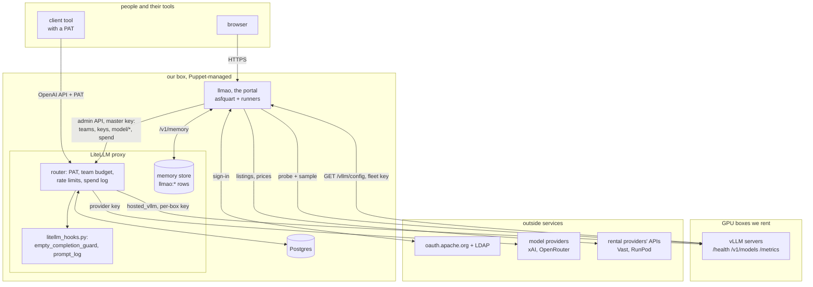
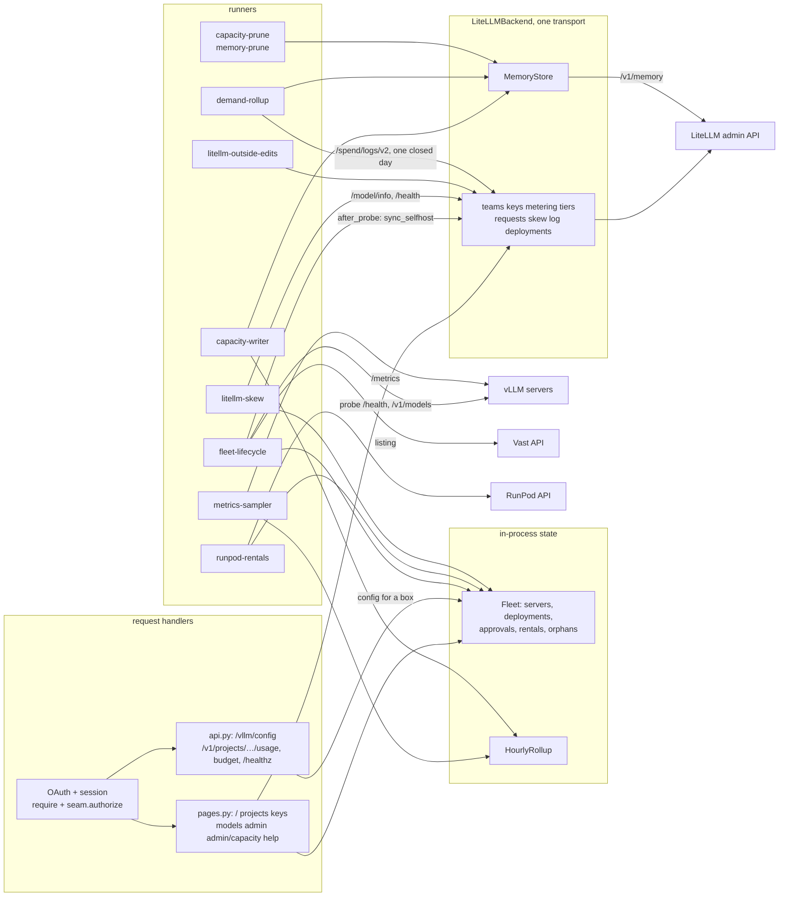
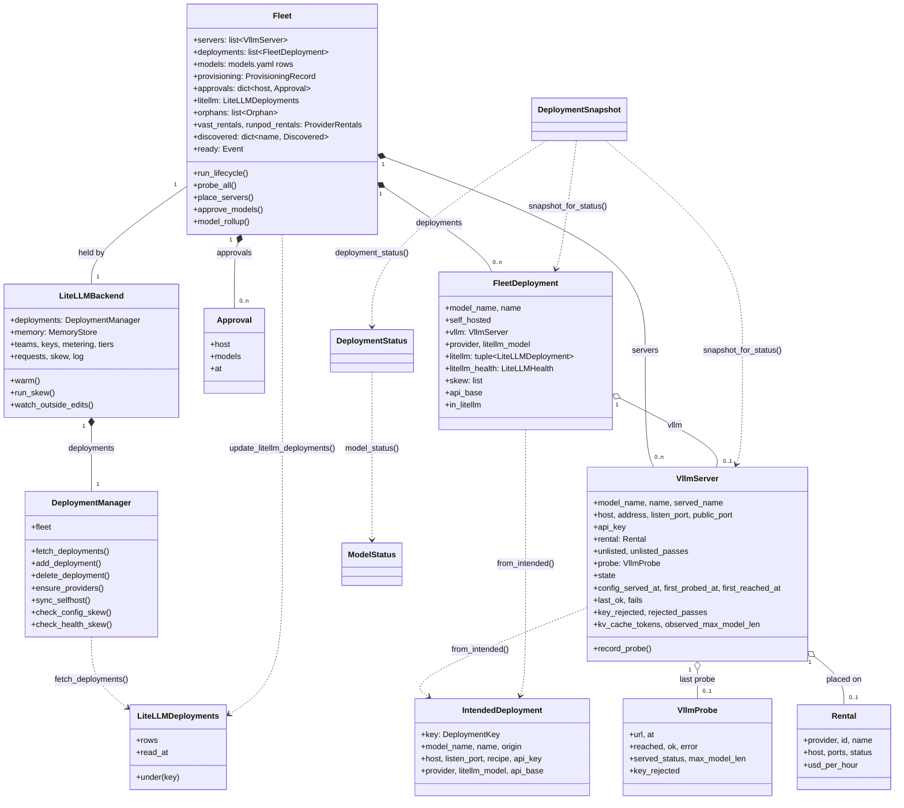
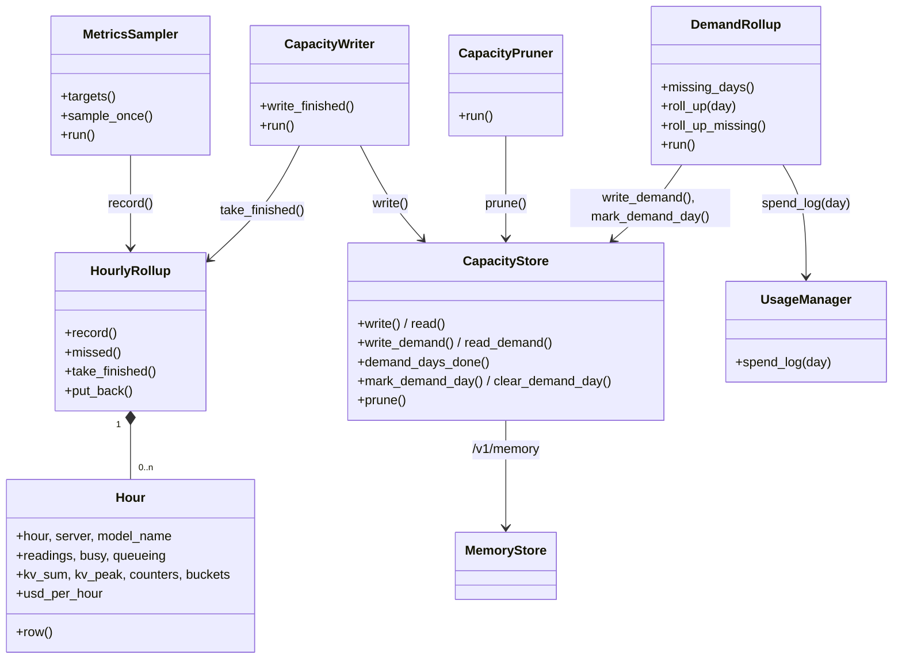

# Architecture

How this repository is put together, written for someone arriving at
it: the pieces, how a request moves between them, where state lives,
and which module owns what. Product intent, credential rules, ownership
and non-goals live in the master design, `apache/rai-private` →
`services/llmao/README.md`. Each part of the system has its own design
doc, linked where it comes up; this document is the map between them.

## The pieces

Two processes are ours, both on one Puppet-managed box, and everything
else is outside.

- **The portal**, this repository, an [asfquart](https://github.com/apache/infrastructure-asfquart)
  application started from `main.py`. It knows who you are at the
  Foundation (OAuth, LDAP), turns projects into LiteLLM teams, issues and
  revokes keys, runs the fleet's control plane, meters the fleet, and
  renders every page. It never carries a prompt.
- **The LiteLLM proxy**, `llm.apache.org`, the inference pipe and the
  meter. A tool calls its OpenAI-compatible API with a key; it checks the
  key, the team's budget and rate limits, routes to a deployment, and
  records the spend. Two callbacks of ours, `litellm_hooks.py`, run
  inside it: `empty_completion_guard`, which rejects a 200 that carries
  no answer with a message saying why, and `prompt_log`, which writes
  every request to the prompt log.
- **Postgres**, LiteLLM's, holding teams, keys, spend and deployments.
  The portal has no database of its own; what it must remember goes in
  LiteLLM's `/v1/memory` store, a key-value table in the same Postgres.
- **The prompt log**, one file per UTC day on `/x1`, written by the hook
  inside the proxy and read only by tools at a shell on the host.
  Design: `docs/prompt-logging-design.md`.
- **The GPU boxes**, virtual machines rented from Vast and RunPod,
  each running one or more vLLM servers. They fetch their configuration
  from the portal at boot and are probed and sampled by it afterwards.
  Protocol: `docs/box-protocol.md`; states: `docs/box-lifecycle.md`;
  provisioning: `hosting/README.md`.
- **Paid providers**, xAI and OpenRouter, behind our own boxes in
  LiteLLM's routing order, for models we do not host or as overflow.
- **Puppet**, in `apache/infrastructure-p6`, renders the three config
  files from one set of node data: `config.yaml` for the portal,
  `litellm.yaml` for the proxy, and the systemd units. `models.yaml`,
  the model recipes, is in this repository and read by the portal only.

The inference path, tool to model, never enters the portal. The portal
sees it afterwards, in LiteLLM's spend log and in the demand values
rolled up from it; the hooks see it as it happens, inside the proxy.

## The flows

Five traces, each from the first touch to the last place it leaves a
mark. Together they are the connections between the pages, LiteLLM, the
log files and the fleet.

### A sign-in

1. The browser reaches the portal over HTTPS and is sent to
   oauth.apache.org. There is no development auth mode; the process is
   always `asfquart.construct(...)`, locally with mkcert certificates
   for `localhost.apache.org`.
2. The session that comes back carries the uid, the committer
   `projects` and the PMC `committees`. That is all the portal knows
   about membership: the current person's projects, never a PMC's
   roster.
3. `llmao/seam.py` turns that into authorization per project: a member
   may see the project; a PMC member, or a site admin named in
   `config.yaml`, may administer it. `@asfquart.auth.require` guards the
   route; the project-scoped rule is the seam's.

### A key

1. On `/keys` a person picks a project and a purpose. A personal key
   binds the ASF uid to the project's team; an automation key is
   team-scoped, and who may create one is an open policy question
   (`docs/STATUS.md`).
2. The seam hands the request to `LiteLLMBackend` (`llmao/proxy/client.py`),
   which speaks LiteLLM's admin API with the master key over async
   httpx. The project is a LiteLLM team whose alias is the project's
   LDAP name; the team id is cached in-process, warmed at startup and
   fail-fast if LiteLLM is down.
3. LiteLLM mints the virtual key into Postgres. The secret is shown once,
   as a flash on the redirect; the portal keeps no copy. From then on
   the key is a PAT a tool presents to the proxy, and the tier limits an
   admin set (`llmao:tiers`) are applied to it there.

### A prompt

1. A tool sends an OpenAI-style request to the proxy with the PAT. The
   proxy resolves the key to its team, applies the budget, the rate
   limits and the per-key tier, and picks a deployment for the model:
   our boxes first, a paid provider only behind them.
2. The request goes to a vLLM server on a box as plain HTTP on the
   provider's public port, authenticated by that box's own bearer. The
   reply streams back through the proxy to the tool. The portal is not
   on this path.
3. As the reply completes, LiteLLM writes a spend row to Postgres and
   calls the two hooks off the request path: the guard turns an empty
   answer into an error that says why, and the prompt log appends one
   JSON record, the prompt and
   the figures but never the response, to the day's file on `/x1`.
   Nothing a client sends switches the log off.
4. Spend and budget reach the pages live: `/projects` reads the team's
   spend from LiteLLM each time, and the usage API reads LiteLLM's
   daily activity.
5. The next day at 01:00 UTC the `demand-rollup` runner reads the closed
   day's spend log page by page, folds it into one demand value per
   model per hour, spawns `bin/llmao-prompt-log rollup --json` for the
   day's file to add what only the log knows, and stores the result.
   `/admin/capacity` reads those values as "What was asked".

### A box

1. An admin rents a machine on Vast or RunPod with our `provision.sh`
   as its entrypoint. The box boots, installs vLLM, and asks the portal
   `GET /vllm/config` with the fleet key, naming itself by the
   provider's instance id in `X-LLMAO-Host`. That name is the server's
   identity: the key it is looked up by in `fleet.hosts`, what its
   bearer is derived from, what an approval is granted to.
2. The portal answers with the servers the box should run, each a
   model recipe from `models.yaml`, a container listen port, and the
   derived key. The public port the provider maps it to is never sent;
   the portal learns it from the provider's listing.
3. The `fleet-lifecycle` runner reads the provider's listing to place
   each server at an address, then probes `/health` and, when the key
   or context window needs asking, `/v1/models`. A server moves through
   Awaiting, Loading, Healthy, and on trouble Unhealthy, Stalled,
   Rejected or Foreign (`docs/box-lifecycle.md`).
4. When a server is Healthy, `DeploymentManager` adds a deployment to
   LiteLLM with `/model/new`, re-reading `/model/info` to confirm, and
   the proxy starts routing to it. When it is down the deployment is
   deleted. `fleet.hosts` plus in-memory approvals are the single source
   of intent; what LiteLLM holds that nothing intends is an orphan,
   shown to admins and never deleted unattended.
5. From then on the `metrics-sampler` reads the server's `/metrics` every
   `sample_interval_s`, folds the readings into the current hour, and
   the `capacity-writer` stores each finished hour as a capacity value.
   `/admin/capacity` reads those as what each server did, beside the
   demand values for what was asked. Design: `docs/capacity-design.md`.

### A day

- **At portal start:** the team-id cache is warmed, the fleet makes its
  first pass before the skew runner is allowed to compare, and the
  demand rollup catches up on every closed day the store lacks.
- **Every interval:** the lifecycle probe (`health_interval_s`), the
  RunPod listing (ten minutes), the skew and outside-edits checks
  (`skew_interval_s`), the metrics sample (`sample_interval_s`).
- **At UTC midnight, inside the proxy:** the prompt log's sink closes
  the day's file, gzips it, and deletes files past
  `prompt_log_retention_days`.
- **At 01:00 UTC:** the demand rollup, an hour's grace for LiteLLM's
  background flush of the spend log.
- **Daily:** `capacity-prune` and `memory-prune` delete what has
  outlived its retention in the memory store.

All of these are runners: `app.add_runner` in `main.py`, each one
`while True` loop with its own interval, listed by name in the portal
diagram under "Reference".

## Where state lives

| Where | What | Written by | Read by | Kept |
|---|---|---|---|---|
| Postgres, LiteLLM's tables | teams, keys, spend log, daily activity, deployments (`store_model_in_db`) | LiteLLM | the portal through the admin API | LiteLLM's own rules |
| `/v1/memory`: `llmao:request:<id>` | access requests | the portal | `/admin` | pending ones always; decided capped at the last 50, lapsed approvals dropped, by `memory-prune` |
| `llmao:tiers` | the tier limits an admin changed, one value | `/admin` | key issuance | overwritten |
| `llmao:skew:` | what the outside-edits check found | `litellm-outside-edits` | the "Work needed" strip | rewritten each pass |
| `llmao:action:<stamp>` | what site admins did | the admin actions | `/admin` Recent work | `action_retention_days`, by `memory-prune` |
| `llmao:log:admin:`, `llmao:log:user:<uid>:` | notices: something happened that the admins, or one person, ought to know | whatever has something to say | `/admin`, the person's pages | until acknowledged |
| `llmao:capacity:<hour>:<server>` | a **capacity value**: what one server did in one hour | `capacity-writer` | `/admin/capacity` | `capacity_retention_days`, by `capacity-prune` |
| `llmao:demand:<hour>:<model>` | a **demand value**: what was asked of one model in one hour, with each project's share | `demand-rollup` | `/admin/capacity` | the same |
| `llmao:demand-day:<day>` | a **day marker**: fold version, sources, count, log status for a rolled-up day | `demand-rollup` | `demand-rollup` | the same |
| `/x1/llmao/prompt-log/prompts-<day>.jsonl`, `.gz` after the day | the **prompt log**: one record per request | the `prompt_log` hook, through loguru | `bin/llmao-prompt-log`, the rollup | `prompt_log_retention_days`, by the sink; root only |
| in the portal's memory | `Fleet` (servers, deployments, approvals, rentals, orphans), `HourlyRollup` (the hour being sampled), the team-id cache | the runners | the pages | lost at restart, rebuilt from config and probing |
| `config.yaml`, `litellm.yaml` | settings, secrets, `fleet.hosts`, providers | Puppet | the portal, the proxy | the node data in p6 |
| `models.yaml` | model recipes, capability chips, governance fields | committers | the portal | this repository |

Per-project token caps are still team metadata in LiteLLM. Those three
stored kinds in the capacity domain have one name each, capacity value,
demand value and day marker; "row" means a row of LiteLLM's spend log
or a line of a rendered table.

### Changing the shape of stored data

Stored values outlive the code that wrote them, so each kind has a rule
for how a change reaches history.

- **Demand values are re-derived.** `FOLD_VERSION` in `llmao/capacity.py`
  is stamped into every day marker. When the fold changes what a demand
  value holds or what counts as demand, the constant is bumped, and the
  rollup's next run treats every day whose marker carries an older
  version as missing: it re-reads that day from LiteLLM's spend log and
  the prompt log, deletes the day's old demand values, writes the new
  ones and a new marker, oldest day first, one day at a time, stopping
  at the first failure and resuming next run. Nobody touches the store
  by hand. Observed on 2026-11-04, version 2 to 3: 89 days, the whole
  retention window, re-rolled in about five minutes, roughly three
  seconds a day, with the page serving throughout and reading a mix of
  old and new shapes, which the reader tolerates. Both design docs name
  the version and what each bump changed.
- **Capacity values are not.** They are written once from `/metrics`
  readings that cannot be taken again, so they carry no version. A
  change to their shape is a change the reader must tolerate for a
  retention window.
- **Prompt log records** gain fields; a reader treats a missing field
  as null, so older files stay readable. The record is built from
  LiteLLM's standard logging payload alone, never from the raw request.
- **Everything else** in the memory store is small enough to be
  rewritten or to lapse under its retention.

## The code

| Module | Role | Design |
|---|---|---|
| `main.py` | construct the asfquart app, build `Fleet` and `LiteLLMBackend`, register the runners | |
| `pages.py`, `api.py` | the HTML pages and the JSON API; both bind to `asfquart.APP` | |
| `llmao/auth.py`, `llmao/seam.py` | identity from the session; authorization per project; the project-scoped team and key operations | `docs/access-control-design.md` |
| `llmao/proxy/client.py` | `LiteLLMBackend`: the one transport to LiteLLM's admin API and its managers for teams, keys, metering, tiers, requests, skew, notices, memory | |
| `llmao/proxy/deployments.py` | `DeploymentManager`: what LiteLLM has, and the only writes that change it | `docs/fleet-reconcile-design.md` |
| `llmao/fleet.py`, `llmao/intent.py`, `llmao/reconcile.py` | the live fleet, what we intend to serve, and the pure joins between intent, boxes and LiteLLM | `docs/fleet-reconcile-design.md` |
| `llmao/provisioning.py`, `llmao/vllm_client.py`, `llmao/vast_client.py`, `llmao/runpod_client.py`, `llmao/rental.py` | the box's config at boot; what we read from a vLLM process; what each provider reports about our rentals | `docs/box-protocol.md` |
| `llmao/model_status.py` | the lifecycle verdicts and the model roll-up, as pure functions of a snapshot | `docs/box-lifecycle.md` |
| `llmao/models.py` | `models.yaml` | |
| `llmao/sampler.py`, `llmao/capacity.py`, `llmao/planning.py` | reading `/metrics`; capacity values, demand values, the rollup and the pruner; what the values say, for the page | `docs/capacity-design.md` |
| `llmao/prompt_log.py`, `litellm_hooks.py`, `bin/llmao-prompt-log` | the record, the day files and the rollup of a day; the hooks LiteLLM loads; the tool the runner spawns | `docs/prompt-logging-design.md` |
| `llmao/access_requests.py`, `llmao/actions.py`, `llmao/pruner.py` | requests a person makes and an admin answers; the admin action log; daily retention | |
| `llmao/token_window.py` | a rolling token allowance as daily buckets | |
| `llmao/fmt.py` | figures and moments as a person reads them | |
| `bin/` | the admin tools run at a shell on the host | `bin/README.md` |
| `analysis/` | the prompt log's reports and content analyses, R&D outside the package; nothing in `llmao/` or `bin/` imports from it | `analysis/README.md` |
| `hosting/` | what runs on the boxes: `provision.sh`, the installer, the RunPod image | `hosting/README.md` |
| `tests/` | the suite, with `MockBackend` and a fake transport; injected only by tests, never a runtime mode | `docs/llmao-harnesses.md` |

## Vocabulary

The words the pages and the fleet code share.

- A **model** is what a user names by the `model` parameter
  (`qwen3-8b`). A **deployment** is one place it is served: a vLLM
  server on a box we rent, or a provider's endpoint. One model may have
  several deployments at once; LiteLLM's `order` puts our boxes first.
- **Self-hosted** means we control the virtual machine, not that we own
  the hardware (the ASF owns none). A model carries a vLLM recipe if we
  can run it ourselves and says nothing about where it is served; that
  is each deployment's.
- **Privacy** is a user-facing field answering "will my prompt leave the
  LLMs we control?": **Private**, served only by vLLM on machines we
  control; **External**, sent to a third party; **Mixed**, both kinds,
  or a deployment config does not list. Mixed is the least private, so
  a Private badge is never shown for a model that could route
  externally, and the wording must not overclaim: a GPU host's operator
  can in principle observe a rented machine's memory.
- A **rental** is a machine as its provider reports it; a **server** is
  one vLLM process on it; a **box** is the machine as we talk to it. A
  server's **name** is the provider's id, its **address** is where it is
  dialed, known only once the listing places it.
- **Usage** is LiteLLM's aggregate, what budgets run on. **Demand** is
  what the rollup derives from the spend log and the prompt log. They
  are compared once, in the reconciliation figure, and never mixed.
- **What users see** per model: Available, Degraded or Unavailable; the
  context window as the minimum across healthy deployments; concurrency
  as an upper bound of full-context requests; never an Awaiting, Loading
  or Stalled deployment. **What admins see** besides: the attention
  strip, a replica summary, and the deployments drill-down with one
  primary action.

## Rules worth knowing

- **Always asfquart.** No dev auth mode. `config.yaml` is loaded as
  `APP.cfg`, an EasyDict, read with dotted access. Standalone
  `python main.py` watches `config.yaml` for changes; production
  restarts the service after Puppet writes it.
- **HTML mutations are `POST /do-*` then 303** to a GET display, with a
  flash for status. JSON handlers use `@api` in `api.py`. Do not wrap
  the Quart ASGI app with Werkzeug ProxyFix.
- **Every write to LiteLLM goes through `LiteLLMBackend`,** and every
  deployment write through `DeploymentManager`, which confirms by
  re-reading. The offline `MockBackend` lives under `tests/` and is a
  test fixture, not a second runtime.
- **Single source of intent.** `fleet.hosts` plus in-memory approvals say
  what should run; servers and LiteLLM deployments are derived. A
  deployment config intends but LiteLLM lacks is a visible skew, not a
  mystery, and nothing deletes an orphan unattended.
- **The proxy-to-box hop is plain HTTP** on the provider's public port,
  authenticated by the per-box bearer. It is not TLS.
- **A service that cannot do what its config says does not start.**
  A missing required setting, or a prompt-log directory that is not
  there, is a startup error, never a quiet default.
- **An exception in a log is a bug.** Recoverable paths are handled;
  what is logged as an exception is something to fix.

Build status and backlog: `docs/STATUS.md`. Quickstart and the API
surface: `../README.md`.

## Reference

### Inside the portal

What runs in this process and what each part reads or writes. The HTML
and JSON handlers answer requests; the runners are the control plane and
the meters; everything they learn sits on `Fleet` or in the memory
store, where the pages read it.

### Class relationships

`Fleet` is built at startup from `config.yaml` (`intent.intended_deployments`
turns `fleet.hosts` and `providers` into `IntendedDeployment` rows) and
holds the fleet state the runners and pages read. `LiteLLMBackend` takes
the same `Fleet`; it and its `DeploymentManager`
(`llmao/proxy/deployments.py`, which adds and deletes deployments and
confirms every write by re-reading `/model/info`) are the only things
that write deployments to LiteLLM. The lifecycle/skew logic in
`model_status.py` is a set of **pure functions**: it takes a
`DeploymentSnapshot` (frozen out of a deployment + its server by
`fleet.snapshot_for_status`) and returns a status object, with no shared
mutable state.

The capacity side has its own small set, all in `llmao/capacity.py` and
`llmao/sampler.py`, sharing nothing with the fleet classes but the
`Fleet` the sampler reads its targets from:

