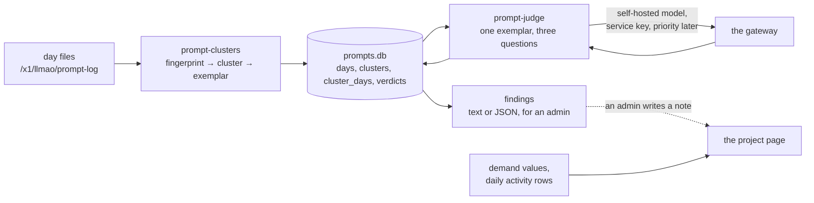

# Prompt analysis: design

What we do with the prompt log, and for whom. `docs/prompt-logging-design.md`
ends where the records exist: one JSON object per request, one file per
UTC day, on the gateway host, and the structural figures folded into the
demand values. This document takes it from there: the questions we ask of
the records, who gets to see which answers, the pipeline that produces
them, and the way an answer gets back to the people it concerns.

Everything here is R&D. It lives in `analysis/` outside the `llmao`
package, and nothing graduates into the package until it settles.

## Goals

1. **Recommendations back to projects and people** on how to use the
   gateway well: a smaller model that would do, a prompt that carries
   more context than the task needs, a completion length that cuts work
   off, a tool configured in a way that wastes the budget. Advice is
   about the **shape** of the use, never its content. Each piece of
   advice is a snapshot: we do not track whether anyone's behaviour
   changed afterwards, because that is expensive and the demand values
   already show a project's model mix at a glance weeks later.
2. **Three questions of the content**, which are the reason the content
   is kept at all:
   - Is this work for the Foundation? The terms say the service is for
     ASF work, and the admins are expected to notice sustained use in
     some other capacity. Evaluating the gateway's models with any
     workload, synthetic or real, few requests or many, is ASF work.
   - Would a lower capacity tier have served? Most traffic goes to the
     largest self-hosted model, and much of it looks like classification
     at six tokens of output.
   - What are people doing with it? A taxonomy of use: security review,
     feature work and bug fixes, code review, evaluating models, and
     whatever else turns up. One of these is a cross-check: unpublished
     security work belongs on the models marked Private, so a security
     review on an external or mixed model is a finding of its own.
3. **Reporting for three audiences**, each from the source it is allowed
   to see:
   - **Admins** see everything, at a shell on the host, content included.
   - **A project**, meaning its PMC members, sees its own work: who is
     drawing on its budget, with which tools and models, how it is
     going. Never a prompt, never another project.
   - **A person** sees their own keys and the shape of their own use.
4. **The people whose prompts these are come first.** Content stays on
   the host, root only, and leaves it only as a finding an admin wrote in
   words. A model that reads prompts runs on our own boxes, never at a
   paid provider, since one project's exemplars must not travel to a
   third party in another project's name. The analysis yields to users:
   one request in flight, in the quiet hours.

## Audiences, sources, places

Two sources, and the line between them is the line between what the
portal may show and what only an admin may read.

| Source | Holds | Who may read it | Where it is read |
|---|---|---|---|
| The demand values (`llmao:demand:`) and LiteLLM's daily activity rows | shape: requests, tokens, tools, models, refusals, latency, prompt lengths, each project's share; keys and users per project | a project's members for their project, admins for all | the portal: `/admin/capacity` today, the project page and the keys page as planned below |
| The prompt log day files | content: the instructions, the messages, the tool, the key | admins, at a shell on the host | the scripts in `analysis/` |

The portal never reads the day files, and the scripts never write to the
portal. What crosses from the content side to the people is a finding
an admin read and chose to pass on, in their own words.

## Architecture

- **The day files** are the input, read once each: a day is scanned,
  its clusters and figures are written to the store, and the day is
  marked as in. A rerun scans only days the store has not seen.
- **`prompt-clusters`** turns records into clusters and chooses an
  exemplar per cluster. Pure string work; no model.
- **The store** is one SQLite file in `analysis_dir`. It is the memory
  between runs: which days are in, what each cluster is, its figures per
  day, its exemplar, and later the judge's verdict on it.
- **`prompt-judge`** (planned) sends each cluster's exemplar to a
  self-hosted model with the three questions and keeps the answer. It
  skips clusters it has already judged, so a run that stops at 200 of
  1,000 picks up at 201.
- **Findings** are what an admin reads: clusters with their figures and
  verdicts, filtered to what needs a decision.
- **The portal's part** reads the demand values and LiteLLM, never the
  store: the project page's panels and, later, a note an admin addressed
  to a project.

## Components

| Component | Where | State |
|---|---|---|
| The shared module: `config.yaml`, the span of days, the fingerprint, the exemplar choice, the store | `analysis/_core.py` | built |
| The reports that need no content: by project, user, model, tool; prompt lengths; shares; failures; messages per request | `analysis/prompt-report` | built; moved out of `bin/llmao-prompt-log` |
| The clusters: scan, store, list, show one | `analysis/prompt-clusters` | built |
| The judge: the questions, the call, the verdicts, the findings | `analysis/prompt-judge`, `analysis/judge-prompt.md` | built; a dry run by default, `--judge` sends; no call made until the key exists |
| The settings | `config.yaml`: `analysis_dir`, `analysis_retention_days`, `analysis_gateway`, `analysis_model`, `analysis_key` | built, optional with defaults except the key; required once p6 renders them |
| The judge's key | a service key named `llmao-analysis` under the `rai` project | the user creates it |
| The project page's panels: tools by model, refusals, latency, prompt lengths, a daily trend, from each project's share of the demand values | `pages.py`, `templates/project.ezt`, `llmao/planning.py` | planned; the data has been in the demand values since fold version 3 |
| A note to a project: written by an admin, dated, shown on the project page until a PMC member acknowledges it | the notices mechanism, a prefix of its own | planned |
| A person's own shape on the keys page: model mix and tokens per key, from LiteLLM's daily rows | `pages.py`, `templates/keys.ezt` | planned; no fold change needed |
| Tests | `analysis/tests/` | the settings and the report so far; the rest when the functions stop moving |

Nothing in `llmao/` or `bin/` imports from `analysis/`. The scripts
import `llmao.prompt_log` for the records and `llmao.fmt` for figures.

## Design

### Words

- **Fingerprint:** the hash key over one record: the project, the
  person, the tool family, and the opening of the instructions.
- **Cluster:** the records sharing a fingerprint. What the scan
  produces; what the exemplar is chosen from; what the store is keyed
  on. No model is involved in making one.
- **Exemplar:** what a person or the judge reads to understand a
  cluster: the head of one record's instructions and a few of the
  cluster's user messages.
- **Activity:** what the people behind a cluster were doing. The judge's
  taxonomy label. Never the cluster's name: a cluster is a structural
  fact, an activity is an opinion about it.
- **Judge prompt:** the fixed questions sent with every exemplar, kept
  as a file. **Verdict:** the judge's answer for one cluster.
  **Finding:** a verdict an admin ought to act on, with the cluster's
  figures beside it.

### The fingerprint

Four parts, hashed together with blake2b at 8 bytes, which is fast,
stable across runs and needs no cryptographic strength: a clash would
merge two clusters and nothing worse.

- **The project**, the key's team alias, or "(no project)".
- **The person:** the key's user, else its alias, else the start of its
  hash. Not the key itself, because a person evaluating models holds one
  key per model and the work is the same: with the key in the hash, the
  Spark review bot's fifteen prompts appeared twice each, once per model.
- **The tool family:** the user agent's product name, the same cut the
  reports make.
- **The opening of the instructions:** the first sentence or line,
  whichever ends first, whitespace collapsed, at most 200 characters.
  The instructions are the first system message, else the Anthropic
  API's `system` parameter, else the opening user message. Not more of
  the text, because a prompt template carries its variable part early
  ("Extract an inventory from each file below. ## Domain: ...") and a
  longer cut makes a cluster per file: the first 1,024 characters gave
  13 clusters of four records where the opening gives one. Not the end,
  because agents append the working directory and the date there.

The cut points and the 200 are set once: changing them changes every
fingerprint and orphans every verdict. The trade-off accepted: two
prompts that open the same way share a cluster. Two of Spark's reviewers
both open "You are a security reviewer." and are one cluster of 653
records; the judge's activity label would be the same for both.

Health checks, listings and deployment-id calls are not demand, by the
same rule the demand rollup uses, and are not clustered.

### The exemplar

Chosen deterministically, so the same records always give the same
exemplar, and the judge is not asked again for nothing.

1. From each record of the cluster, take its last user message that is
   text: a string, or text parts only. Tool results and images on the
   way back are skipped, since they are not something a person typed.
   Collapse whitespace; drop it under 20 characters ("continue", "y").
2. Drop duplicates by hash.
3. Rank by how close the record's prompt length is to the cluster's
   median prompt length, earliest timestamp first among equals. The
   typical request, not the biggest and not the first, which is often a
   smoke test.
4. Take the first three, each cut to 1,500 characters. The exemplar's
   call id and its head, the first 1,024 characters of the instructions,
   are the first one's.

The exemplar is chosen when the cluster is first seen and stored with a
hash over the head and the messages. It is re-picked only when the
cluster's record count has at least doubled since the pick, from the
records of the days being scanned, which bounds the judge's extra work to
a handful of calls over a cluster's life and leaves a steady cluster
alone. A rerun over the same days produces the same hash and no new
judge call.

### The store

`analysis_dir/prompts.db`, SQLite from the standard library, in WAL
mode, one writer.

| Table | Key | Holds |
|---|---|---|
| `days` | day | that the day is in, when it was scanned, how many records |
| `clusters` | fingerprint | project, person, tool, where the opening came from, the opening, first and last day seen, record count, the exemplar (call id, head, messages, hash, record count at the pick, the day of the pick) |
| `cluster_days` | fingerprint, day | requests, failures, prompt and completion tokens, their medians, requests per model |
| `verdicts` (planned) | fingerprint, judge prompt hash, model | exemplar hash, when, the verdict as JSON |

Why SQLite rather than a JSONL file of verdicts: the restart check is a
primary key lookup rather than a scan, a crash leaves no half-written
line, the day scan becomes incremental because the figures per day are
rows, and the findings are a query. The cost is a schema that will churn
while this is R&D, met two ways: the verdict is one JSON column, so a
change in what the judge returns needs no migration; and `--rebuild`
drops the days and clusters, which are cheap to re-derive, and never
the verdicts, which cost model calls.

Every row older than `analysis_retention_days` is pruned at each run,
clusters whose last day fell off included, with their verdicts. One
value for all analysis output; it defaults to the prompt log's
retention, since the store holds text from the log and must not outlive
it.

The store is derived, and the scan writes what the code of the day
said. A change to the fingerprint's parts, the person's name or the
exemplar leaves an existing store stale until its days are scanned
again: `--rebuild` over the span, after pulling such a change. There is
no versioning of the store while it is R&D, unlike the demand values'
fold version; the first stale listing on 2026-11-05 was the master-key
naming, fixed by a rebuild. A verdict whose fingerprint no longer exists
is dropped at the next prune.

A rebuild is cheap, about 12 seconds for a day of 4,800 records; it is
string work and SQLite. Judging is the slow part, about 2.5 seconds per
cluster through the gateway with one request in flight, so verdicts are
what the store protects: kept across rebuilds, re-judged only when the
judge prompt, the exemplar or the model changed.

### The judge

One call per cluster, carrying the judge prompt and the exemplar: the
head, the messages, and the cluster's figures as plain numbers
(requests, mean prompt and completion tokens, the models used, and how
many requests were the same request sent to more than one model),
because the tier question needs the size of the work and the cut
messages hide it. The answer is fixed in shape: the three questions, one
answer each, and a sentence of reasoning, as JSON.

Two figures carry rules, learnt from three judges on one day. They
agreed on Foundation work 23 of 23 times and on the activity 19 to 22
of 23, but on the tier only 8 to 13 of 23: gemma4-26b called 19 of 23
clusters low, the 8b called 14 medium, the int4 27b called five high.
"Would a smaller model do" is a self-assessment, and a strong model
finds the work easy. So the judge prompt now decides the tier from the
completion length first, a few tokens out being a label and low, long
completions over agent work being high, and in doubt the higher tier,
since underestimating the work is the costly mistake (a colleague's
point: lean high). And the paired count, the same request sent to more
than one model, marks a person comparing models, which is Foundation
work whatever the requests contain; the judge cannot see that from one
exemplar, and without it a model-evaluation batch of German emails was
judged non-Foundation work by all three judges.

- **A self-hosted model only.** The exemplars are other projects'
  prompts, and they do not leave our boxes. The default is `qwen3-8b`, a
  small and fast categoriser; the int4 27b if it turns out to need more.
  The model name is part of what makes a verdict stale, so switching
  re-judges everything once and never mixes two models' answers.
- **A verdict is stale** when any of three things changed: the judge
  prompt (its hash is stored with the verdict), the exemplar (likewise),
  or the model. Rewording the questions re-judges every cluster on
  purpose; a re-picked exemplar re-judges one.
- **Restartable:** each verdict is its own transaction, written as it
  returns. A run that stops at 200 of 1,000 keeps 200 and resumes at
  201. The judge skips every cluster whose verdict is not stale, so the
  normal daily run judges only the clusters the day brought.
- **Through the front door,** `https://llm.apache.org` by default
  (`analysis_gateway`), not the proxy's local address: the judge is a
  client like any other, so it runs the same from a developer's machine
  against a copy of the store as from the host, and its calls are
  attributed, logged and counted like anyone's. The key is a service key
  named `llmao-analysis` under the `rai` project. The scan never
  clusters that key's own requests. Its calls land in the prompt log
  carrying other projects' exemplars; that is the same content under
  the same access, and accepted.
- **A dry run by default.** Without `--judge` the script prints the
  first request it would send and how many clusters lack a verdict, and
  sends nothing. The synchronous httpx client, one request at a time.
- **The master key is never judged.** Its clusters are the operators'
  smoke tests, which the judge cannot tell from a person's questions
  about the weather; the listing marks them and a footnote says why.
- **Several judges side by side.** The model is part of a verdict's key,
  so `--model` judges with a second model and keeps its verdicts beside
  the first's, and `--compare` lists the two together with the clusters
  where they differ. That is how the 8b's noise on the tier question is
  measured against the int4 27b before either is trusted.
- **The tier report.** For each judged cluster, the judged tier against
  the models it used, with `analysis_tiers` saying which model serves
  which tier: the requests on a heavier model than the work needs are
  the saving to recommend, the requests on a lighter one the risk.
  Heaviest excess first.
- **Yielding to users:** one request in flight, run in the quiet hours
  after the 01:00 UTC rollup. A request-level priority on our boxes,
  which would let the judge's calls queue behind everyone's, is
  possible with vLLM's priority scheduling but is not safe until the
  proxy strips the field from everyone who is not allowed to set it;
  that idea is parked as issue #72.

### The settings

Four flat keys in `config.yaml` beside `prompt_log_dir`:

| Key | Meaning | Default while optional |
|---|---|---|
| `analysis_dir` | where the store lives | `./analysis-data` |
| `analysis_retention_days` | how long every row of the store is kept | `prompt_log_retention_days`, then 90 |
| `analysis_gateway` | the gateway the judge calls, through the front door | `https://llm.apache.org` |
| `analysis_model` | the judge's model | `qwen3-8b` |
| `analysis_key` | the judge's gateway key | none: the judge stops before its first call |
| `analysis_tiers` | which models serve which tier, first to recommend, for the tier report | low: qwen3-8b, qwen3.5-9b; medium: qwen3.8-27b-int4; high: qwen3.8-27b, gemma4-26b. A guess to correct |

Optional with these defaults until p6 renders them, in two steps: the
scripts code the defaults now, with a note to update p6; once p6 renders
the keys they become required, like `prompt_log_dir` already is.

### Failing hard

A script stops with a message on a missing `config.yaml`, a missing
required key, a day file it cannot read, a judge call that fails, or a
model name that `models.yaml` does not define, whether the judge's, one
to compare with, or any in the tier map. It can fail harder than the
portal: a startup error there takes a service down, here it makes the
admin fix their invocation. The same check in the portal, when it reads
settings that name models, would be a warning. No script ever
opens a connection to LiteLLM except the judge's model calls, and none
writes in the log directory.

### What goes back to people

Advice is about shape: which model, how much prompt, how long a
completion, how a tool is configured. Never the content of a prompt,
never a quotation from one. Each piece is a snapshot with a date, and
nothing is built to track whether it landed.

The first channel is the simplest: an admin reads the findings and
writes to the project. The second is a note on the project page,
addressed to the project by an admin, dated, acknowledged by a PMC
member when read, stored like the notices that `/admin` already shows.
The script never writes to the portal; an admin always stands between a
finding and a person.

## Decisions

Made 2026-11-04. Each is a choice, recorded so it is not re-derived.

1. **R&D lives in `analysis/`,** a top-level directory, not in `bin/`
   (admin tools, stdlib only, no environment to install) and not in
   `llmao/` (the product). The library holds only what the scripts read
   through: the records and the figures. Nothing in `llmao/` or `bin/`
   imports from `analysis/`.
2. **The reports moved out of the tool.** `bin/llmao-prompt-log` keeps
   only `rollup`, which the portal's runner spawns, and takes its
   directory on the command line; it never reads `config.yaml`. The
   reports are `analysis/prompt-report`.
3. **`config.yaml` is read by the scripts, not by the library.**
   Everything in `llmao/` uses the config the portal loaded in `main.py`.
4. **The person, not the key,** in the fingerprint.
5. **The opening, not the head,** in the fingerprint; the head in the
   exemplar.
6. **SQLite, not JSONL,** for the store; `.db` as the suffix.
7. **The exemplar is frozen on first sight** and re-picked only on a
   doubling.
8. **The judge runs on a self-hosted model,** `qwen3-8b` by default,
   through a service key under `rai`; its calls landing in the prompt log
   is accepted.
9. **One retention for all analysis output.**
10. **No request priority yet** (issue #72); the judge throttles itself.
11. **Scripts fail hard.**
12. **Scripts run through uv:** the shebang is
    `#!/usr/bin/env -S uv run --script`, so `./analysis/prompt-clusters`
    runs in the project's environment from the checkout. Pre-commit does
    not identify that shebang as Python, so the ruff hooks run over the
    tree and `extend-include` in `pyproject.toml` names the scripts.
13. **Snapshots, no tracking over time.**
14. **Evaluating the gateway's models is ASF work,** whatever the
    workload. Non-ASF use means sustained real work in another capacity.
15. **The portal never runs analysis** and never reads the day files or
    the store. Its project and keys pages are fed by the demand values
    and LiteLLM.
16. **The tier leans high** (2026-11-05). The judge is told to decide it
    from the completion length and to pick the higher tier in doubt; a
    recommendation to downgrade comes only with strong evidence, and the
    "lighter" column of the tier report is the one to act on first.
17. **The same request to several models is model evaluation** and so
    Foundation work (2026-11-05), measured at scan time and told to the
    judge as a figure.

## Roadmap

| Step | What | State |
|---|---|---|
| A1 | The split: `analysis/` with `_core.py`, `prompt-report`, `tests/`; `bin/llmao-prompt-log` down to `rollup` | done 2026-11-04 (c8c4f46) |
| A2 | `prompt-clusters`: fingerprint, cluster, exemplar, the store, prune, rebuild, list, show, JSON | done 2026-11-04 (43ed1de); the full day of 2026-11-04 ran in 12 s: 4,847 records, 66 clusters |
| A3 | The judge: `judge-prompt.md`, `prompt-judge`, the verdicts table, the stale check, one verdict per transaction, the settings | built 2026-11-04; dry run verified against the day's 66 clusters, 64 with an exemplar; the first real run waits on the `llmao-analysis` key |
| A4 | Findings: the clusters of the span with their verdicts, text or JSON, and the reasons | built with A3 as `prompt-judge --findings`; what counts as a finding worth acting on is refined once verdicts exist |
| A5 | p6: the four keys rendered, the directory created; then the keys become required | a PR beside A3, not waited on |
| A6 | The project page's panels from each project's share of the demand values; the sharper form of the "Usage Analysis page" the logging design parked | planned, in `llmao/` |
| A7 | A note to a project, written by an admin, shown until acknowledged | planned, in `llmao/` |
| A8 | A person's own shape on the keys page, from LiteLLM's daily rows | planned, in `llmao/` |
| A9 | The taxonomy refined against real verdicts, with colleagues; tests for `_core.py` once its functions stop moving | later |

The step numbers continue the logging design's: its N9, "which content
analyses, and where they run", is this document, and its N10, the parked
Usage Analysis page, is A6.
