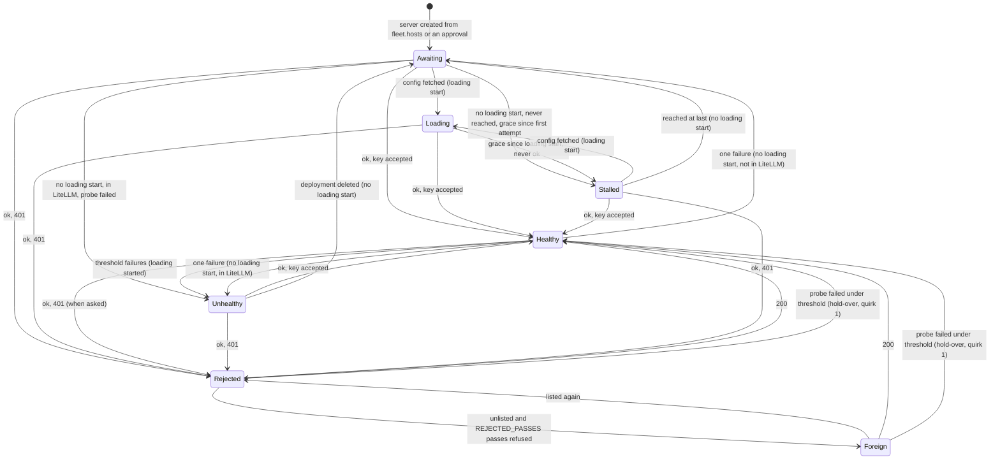

# The self-hosted box lifecycle

What llmao believes about one vLLM server on one of our GPU boxes, how
that belief changes, and what each belief makes llmao do. This is the
state machine as the code runs it today (`llmao/model_status.py`,
`llmao/fleet.py`, `llmao/proxy/deployments.py`, `pages.py`), not the
reconcile design; where the two differ, `docs/fleet-reconcile-design.md`
says what is planned.

One server is one row of `fleet.hosts` (or one approved model on an
unknown box): a host, a listen port, a model. Its lifecycle is a name
recomputed on every probe pass from a handful of stored observations.
There is no transition table in the code; `self_hosted_lifecycle` is a
pure function of the observations and the clock, and the diagram below
is what that function implies.

## The observations

Everything the lifecycle reads, and where it comes from.

| Observation | Set by | Meaning |
|---|---|---|
| `config_served_at` | `Fleet.update_config_fetches`, each probe pass, from the box's last `GET /vllm/config` | A **loading start**. The box has been told what to run, so a loading window has started. `None` until then. |
| `probe_ok` | each `/health` probe | `True` on a 200: vLLM says it is serving. Not "all is well": `/health` takes no key. |
| `reached` | each probe | Any HTTP answer at all, a 503 included. `False` is no connection or a timeout. |
| `first_reached_at` | the first probe in this process that vLLM answered | The other **loading start**: vLLM is listening, so the model is loading, whether or not this process served the config (an approved host that fetched before a restart never fetches again). The loading start is the earlier of the two. |
| `first_probed_at` | the first probe attempt in this process | The clock for a server that has no loading start and never answers. "No address to dial" counts as an attempt when the host is unlisted. |
| `last_ok`, `fails` | each probe | When `/health` last passed, and the consecutive failures since. |
| `key_rejected`, `rejected_passes` | `/v1/models` with the working key, asked only when `/health` passed | `True` on a 401. The passes count runs while refused; a 200 or a failed probe resets it. |
| `litellm`, `litellm_health` | the LiteLLM deployments read (`Fleet.update_litellm_deployments`) and LiteLLM's own `/health` read (`Fleet.update_litellm_health`) | The deployments LiteLLM has under this one's key, its stamp (`in_litellm` is read off them; more than one is duplicates), and LiteLLM's last verdict on it with its time. |
| `unlisted` | `Fleet.place_servers`, from the Vast and RunPod listings | Host-level: every configured provider has answered and none names this host, for `UNLISTED_PASSES` passes running. |

The clocks: `health_interval_s` (45 s between passes), `health_grace_s`
(1800 s, the loading window), `health_fail_threshold` (3, both the
failures that turn Healthy into Unhealthy and the missed passes after
which a signal is stale). The pass counts: `UNLISTED_PASSES` 3 (the
listing clock), `REJECTED_PASSES` 3 (the Rejected-to-Foreign debounce),
`ORPHAN_PASSES` 3 (the skew clock: passes before a LiteLLM deployment no
server claims is shown as an orphan; not part of this machine).

When `/v1/models` is asked: on every pass in which `/health` passed and
the server was not already Healthy, or its served window has never been
read, or its key was refused last time, or its host is unlisted. A
Healthy, listed box whose window is known is not asked again.

## The states

| State | Means | LiteLLM | Shown as |
|---|---|---|---|
| **Awaiting** | No loading start, and nothing decisive observed. The box has not fetched its config, or a probe reached it but it is not up. | nothing | "has not requested its config", or the last probe |
| **Loading** | Loading started, not yet up, inside `health_grace_s` of the start. | nothing | "vLLM up, model loading" (reached) or "vLLM not listening yet" |
| **Healthy** | `/health` 200 and the key not refused. | **add** the deployment when it has a public address and is absent | green when in LiteLLM; yellow "Not in LiteLLM" until then |
| **Unhealthy** | Was up, now `health_fail_threshold` failures running (loading started), or any failure while in LiteLLM with no loading start. | **delete** the deployment | attention item |
| **Stalled** | Loading started and never up past the grace; or no loading start, never reached, past the grace from the first attempt. | **delete** the deployment | attention item |
| **Rejected** | `/health` 200 but `/v1/models` 401 with the working key. | **delete** on the first 401 | attention: "vLLM is up but rejects our key... Check the api key on the box." |
| **Foreign** | Rejected for `REJECTED_PASSES` passes running, and the host is unlisted: something else is serving there. | **delete** | attention, with "If so, remove it from fleet.hosts." |

"Add" and "delete" are what `sync_selfhost` does after each probe pass,
and what the Fleet buttons may do by hand; both apply the same gate
(`add_refusal`, `remove_refusal`). The delete gate has one more clause:
an unlisted server that is not Healthy loses its deployment whatever its
state, Awaiting and Loading included. A serving box keeps its route
whatever a listing claims.

The roll-up for a model counts Healthy, Unhealthy and Rejected rows whose
probe signal is fresh. Any Healthy row: Available; Available with an
Unhealthy or Rejected row beside it: Degraded; none: Unavailable.
Foreign is not counted at all: it is not our box. A row whose last probe
is older than three intervals is stale, and stale is unknown, not down,
so it drops out of the count.

## The diagram

Every arrow is one probe pass (or one config fetch) changing the name.
"ok" is a 200 from `/health`; "401" and "200" are `/v1/models` with the
working key; "grace" is `health_grace_s`; "threshold" is
`health_fail_threshold`.

A failed probe also resets `rejected_passes`, so after the hold-over a
box that still refuses the key is Rejected again and needs three more
refused passes to read Foreign. Unhealthy is reached from Rejected or
Foreign only through the hold-over: three failures running.

The loading start matters more than the diagram can show: the same observation
names a different state depending on whether loading has started
(`config_served_at` or `first_reached_at`). The decision order in
`self_hosted_lifecycle` is:

1. `/health` passed: Rejected if the key was refused (Foreign if also
   unlisted past the passes), else **Healthy**. Always, including the
   first probe after a control-plane restart.
2. No loading start: in LiteLLM and the probe failed, **Unhealthy** (it was
   serving before a restart; now it is not). Never reached and past the
   grace from the first attempt, **Stalled**. Otherwise **Awaiting**.
3. Loading started and once up: **Unhealthy** at the threshold, **Healthy**
   under it (hold-over-the-threshold).
4. Loading started, never up: **Loading** inside the grace, **Stalled** past it.

A control-plane restart loses every observation: each server starts
Awaiting with no loading start, and the first pass names it again from what it
sees. A serving box is Healthy at once; a box in LiteLLM that does not
answer is Unhealthy at once; a box answering 503 is Loading from that
answer; a box still pulling its image is Awaiting until it fetches its
config, or Stalled after the grace if it never answers.

## Two overlays that are not states

**Unlisted** is a verdict on the host, not the server, and it changes
what a state means rather than which state it is:

| Unlisted and... | Reads | Attention strip |
|---|---|---|
| Healthy | serving through a listing gap | "No Vast or RunPod instance has this address, but it is serving; the listing may be behind." No buttons; the route stays. |
| Awaiting, Loading | a box the listing has lost, still inside its window | "the rental may have ended." No sentence. Its deployment, if any, is deleted. |
| Unhealthy, Stalled | a dead rental | "...the rental may have ended. If so, remove it from fleet.hosts." |
| Rejected | a refusal that may yet be ours | "...the rental may have ended." No sentence until the passes run. |
| Foreign | someone else's box at our old address | "...and the vLLM there rejects our key; it may be someone else's now. If so, remove it from fleet.hosts." |

Unlisted also clears the server's box (its provider, price and listing
status), and a host with no public port and no listing records a
"no address to dial" probe so the Stalled clock runs. A host no listing
has ever named is unlisted like any other once the passes run, so a
rental that ended while llmao was down is said after the restart. A pod
that the listing still names in any status, stopped or initializing, is
listed; only absence is a miss.

**An approval** (`intent.Approval`, kept on `Fleet`) is a person vouching
for a host that `fleet.hosts` does not name and choosing its models. It is
intent, like a `fleet.hosts` row: the host leaves the attention strip the
moment it is approved, its servers are created (Awaiting, one per model on
the listen ports in order) and read with the other deployments, and its
next config fetch is served; the lifecycle's probe pass takes them from
there. The rows carry "Approved · 5m ago" so an admin can see why
they are there. An approval never changes a computed state.

Approvals are process memory, lost on restart, and so is the record of
the unknown box that asked. A box asks for its config once: on a 404 the
installer exits and the box sits idle, so after a restart there is
nothing in the strip to re-approve, and the box is invisible until its
provider's rentals name it, when the strip shows it as a rental nobody
intends. A box its provider reports that has also asked is one strip
item, not two. Until a provider names it the way back is by hand:
reboot the box so it asks again. Membership in
`fleet.hosts` is the durable gate, so a recycled address gains nothing
from a stale approval. There are no other admin marks on a host: a box
that failed to provision is rebooted by hand and shows itself the moment
it re-requests config and reads Loading.

## Skew badges

Skew is reserved for a genuine disagreement between sources. "vLLM is not
up yet, so there is no LiteLLM deployment" is Loading, not skew. The
lifecycle emits these six badges and nothing else (`SKEW_PHRASE` in
`model_status.py`):

| Badge | Means | Clears when |
|---|---|---|
| Intended, not in LiteLLM | A deployment config intends, and LiteLLM lacks. Emitted only for Healthy, or for a commercial deployment that is Configured. | `sync_selfhost` adds it, or Add does. |
| vLLM up, LiteLLM down | The probe passes but LiteLLM's own `/health` reports the endpoint down. The two signals carry their own ages, so a difference reads as two snapshots, not a contradiction. | LiteLLM's next health pass agrees. |
| vLLM down, LiteLLM up | The reverse. | likewise |
| In LiteLLM, not in config | An orphan: a LiteLLM deployment whose stamp no intended one has, or with no stamp at all, whatever address it sits at (`Fleet.orphans`, rebuilt on every read). On the strip after `ORPHAN_PASSES` reads, saying who added it: llmao's own add carries the `llmao_key` stamp, a hand add in LiteLLM has none. Never deleted unattended. | Stop tracking; an approval of the host, or a config row, that claims it |
| Duplicated in LiteLLM | LiteLLM holds more than one deployment under this key: it keeps a second copy when asked twice, and every copy takes traffic. | the extra copies are deleted (every copy goes when the deployment is dropped; removing extras from a serving one is the plan's) |

A signal is stale after `health_fail_threshold` missed intervals (about
2.5 minutes for the probe, about 12 hours for LiteLLM's health). Stale
reads as Unknown, never as Down, and drops the row out of the roll-up.

## Decisions with a history

Rulings that shaped the machine, kept so they are not relitigated by
accident.

- **Retirement is not a state.** Retiring a box is manual teardown: remove
  it from `fleet.hosts`; its deployment then reads as an orphan on the
  strip, and Stop tracking removes it. Once off the fleet the row
  disappears rather than accumulating in Stalled.
- **Reboot is observed, not assumed.** Rebooting through a provider's API
  gave unclear results once, so a reboot is done by hand in the provider's
  console and the lifecycle reports what it sees. A "Reboot requested"
  label was tried and removed (2026-10-27): the probes already say what
  the box is doing. A Reboot button is a TODO for when a provider API is
  verified to reboot a box and, better, to report its state.
- **One grace window.** `health_grace_s` is the only loading timeout, from
  the loading start (or the first attempt) to Stalled. Big models load slowly, so
  it is config, not a constant.
- **A serving box keeps its route.** Whatever a listing claims, a box that
  answers `/health` with our key accepted is never deleted from LiteLLM.
  Learned from the listing-gap incident described in `fleet-reconcile-design.md`.
- **`ok` means contacted, not well.** A 200 from `/health` is vLLM's word
  that it is up; the key verdict is separate. The variable name predates
  Rejected and may be renamed in its own commit.
- **A stale signal is unknown.** Never down. Counting a stale row as down
  would make a paused control plane read as an outage.

## Quirks in the machine as it stands

Found while drawing it. None is fixed here; each is a candidate for the
reconcile migration.

1. **A refused box reads Healthy through a probe blip.** The hold-over
   rule (under the threshold, keep the last name) runs on the
   `/health`-failed branch without looking at `key_rejected`, so a
   Rejected or Foreign box whose next probe times out is Healthy for up
   to two passes. `sync_selfhost` adds its deployment back, and the
   pass after that deletes it again when the 401 returns. A blip on a
   Rejected box flaps the route.
2. **A never-reached box in LiteLLM has no hold-over.** After a
   control-plane restart, a box LiteLLM still has that never answers is
   Unhealthy on its first failed probe, not its third, because the
   not-started branch checks `in_litellm and probe failed` before
   anything else. Once `sync_selfhost` has deleted the route it reads
   Awaiting, then Stalled after the grace. A box that answered once in
   this process has a loading start and the ordinary hold-over.
3. **A Healthy, listed box is never re-asked for its key.** `/v1/models`
   is asked on the way into Healthy and again only while refused or
   unlisted. A key rotated on a box that stays up is caught by LiteLLM's
   own health check (the "vLLM up, LiteLLM down" skew badge), not by the
   probe.
4. **Stalled has two meanings.** Started-and-never-up past the grace,
   and never-reached-with-no-start past the grace from the first
   attempt. Both delete the deployment and show the same attention item.
   The second becomes the first the moment a probe reaches (a 503): that
   probe is a loading start, and the grace runs from it.
5. **The unlisted delete gate reaches Awaiting and Loading.** A box in
   its loading window whose listing is behind loses its deployment,
   which is harmless (it had nothing to serve) but is a different rule
   from "down deletes".

## Where to read the code

- `llmao/model_status.py`: the state names, `self_hosted_lifecycle`, the
  roll-up and staleness (`deployment_status`, `model_status`).
- `llmao/fleet.py`: `VllmServer.record_probe` (the counters and the
  transition log lines), `Fleet.probe_all` (when `/v1/models` is asked),
  `Fleet.place_servers` and `apply_rentals` (listed, unlisted, the public
  port), `update_config_fetches` (the loading start), `discover_rentals` (a
  rental nobody intends, never added on sight), `add_refusal` and
  `remove_refusal` (the button gates).
- `llmao/proxy/deployments.py`: `sync_selfhost` (the automatic add and
  delete after each pass).
- `pages.py`: `_deployment_reason`, `attention_items`,
  `_needs_attention` (what an admin sees for each state).
- `tests/test_model_status.py` and `tests/test_fleet_health.py`: one
  test per arrow above, more or less.
