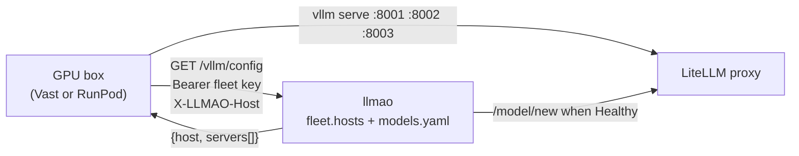

# How a GPU box asks for its configuration

The contract between a GPU box and llmao: the one request a box makes at
boot, what it must present, and what it gets back. This is how the fleet
works today, not a proposal. Box boot on each provider is
[`../hosting/README.md`](../hosting/README.md); how the running fleet is
kept in step with LiteLLM is
[`fleet-reconcile-design.md`](fleet-reconcile-design.md).



llmao is the source of truth for which models exist, how each is served
(`models.yaml`), which box serves what on which port (`fleet.hosts`), and
the bearer LiteLLM presents to each vLLM. The box learns all of it from one
JSON response. There is no long-lived process manager on the box: the
installer writes Supervisor units and exits.

## The request

```
GET /vllm/config
Authorization: Bearer <fleet.key>
X-LLMAO-Host: <the box's name in fleet.hosts>
```

- **The fleet key** is the gate. `config.yaml` `fleet.key` is one shared
  secret, baked into every box template and checked present at startup
  (`validate_fleet`, like the salt). Missing from the request: 403.
  Wrong, by a constant-time compare: 403.
- **The host** is the `fleet.hosts` key the answer is built for. When
  `X-LLMAO-Host` is present it is the only key: no fallback to the peer,
  and 404 if it is unknown. Vast instances reach llmao through a transparent
  proxy, so the TCP peer is not the instance and there is no
  `X-Forwarded-For`. Without the header, the leftmost `X-Forwarded-For`
  address is used, else the peer. The header is a claim, not a proof; the
  fleet key is what is checked.
- **Which name a box sends** is the provider's business, set in that
  provider's `provision.sh` as `LLMAO_HOST`: the instance id on Vast
  (`CONTAINER_ID`), the pod id on RunPod (`RUNPOD_POD_ID`). `install_set.py`
  knows no provider's names. llmao only matches the name against the keys
  of `fleet.hosts`, and never dials it: a server's address is unknown
  until the provider's listing places it on a machine with an address,
  since the listing carries both the address and the name a box on that
  machine sends. A row keyed by an address, as the legacy boxes and those
  provisioned before names were ids are, is its own address and still
  places by it. (The RunPod image has not yet run on a real pod.)
- **Every fetch is recorded by name** (first and last seen, a count; the
  `ProvisioningRecord` in `llmao/provisioning.py`, capped, oldest
  last-seen first), whether or not the name is intended, and logged with
  the claimed host, the peer and `X-Forwarded-For`. The record does not
  know membership: that is the fleet's join. A name nothing intends gets
  404 and shows on the `/models` attention strip as "fleet key presented
  from a host not in `fleet.hosts`", with Approve.
- **The last fetch by an intended name is its loading start.** Each probe
  pass reads the record onto the name's servers: a box that fetched its
  config and is not yet answering is Loading until `fleet.health_grace_s`
  has passed, then Stalled. The whole state machine is `box-lifecycle.md`.

Boxes fetch `https://llm.apache.org/vllm/config` with default TLS
verification.

## The response

```json
{
  "host": "203.0.113.10",
  "servers": [
    {
      "name": "gemma4-26b",
      "model": "google/gemma-4-26b-it",
      "served_model_name": "gemma4-26b",
      "host": "203.0.113.10",
      "port": 8001,
      "api_key": "sk-vllm-...",
      "args": ["--reasoning-parser", "gemma"],
      "max_model_len": 32768,
      "vram_gb": 18,
      "disk_gb": 60
    }
  ]
}
```

One entry per vLLM process on the box, joined from the host's `fleet.hosts`
rows and the `models.yaml` recipe each names.

- `name`: the process name, the row's third element when it has one, else
  the model name. Supervisor's program name and the log file name.
- `model`: the HF weights id (`model_info.vllm.model` in `models.yaml`).
  `served_model_name` is the name vLLM advertises on `/v1/models`.
- `port`: the **listen** port, what `vllm serve --port` binds. Never the
  public port a provider maps it to; the box does not need to know that.
- `api_key`: the bearer this vLLM must require (`--api-key`), derived as
  below. LiteLLM presents the same value.
- `args`: extra `vllm serve` arguments. A list of strings, or one string
  the installer splits.
- `gpu_memory_utilization`, `max_model_len`, `vram_gb`, `disk_gb`,
  `kv_bytes_per_token`: present only when the recipe sets them.
  `gpu_memory_utilization` is normally absent; the box divides the card's
  memory between its servers from `vram_gb`. `vram_gb` and `disk_gb` are
  what the box checks before pulling weights.

Beside `servers`, the payload may carry `hf_token`: the Hugging Face token
from `fleet.hf_token`, one for the box rather than per server. The installer
sets it as `HF_TOKEN` in every program's environment. Absent when llmao has
none, and an installer that predates the field ignores it.

## Hosts and ports

A `fleet.hosts` entry is the box's name (above) mapped to rows of
`[model_name, port]` or `[model_name, port, name]`. The port is the
container listen port, one of 8001, 8002 or 8003 (`VLLM_LISTEN_PORTS`;
a box gets at most three), plus the handful of older pairs in
`LEGACY_SERVERS`. The optional name lets two processes share one
`models.yaml` row.

A provider publishes each listen port on some other public port. llmao
learns that mapping from the provider's listing (Vast's instance ports,
RunPod's `portMappings`) and uses it for everything that dials the box:
the LiteLLM deployment's `api_base`, the health probe, the `/v1/models`
read and the metrics sampler. A fourth element on a host row, a public
port written by hand, is deprecated: it loads with a warning and only
seeds the port until the listing names the box. Without a Vast key
configured the fleet is taken to be local and public equals listen; a
RunPod-only configuration reads as local too, which is a wart to fix when
one exists.

llmao owns placement. `models.yaml` says how to serve a model, not where.
Moving a model between boxes is a config change and a restart of llmao;
the box templates are identical and never change.

### Three config lifetimes

| lifetime | what | to change it |
|---|---|---|
| **baked** | `FLEET_KEY`, `ASFQUART_URL` in the box template | re-provision |
| **boot** | the assignment: model, port, launch args, `max_model_len` | the box must re-fetch and restart vLLM |
| **live** | deployments, keys, budgets in LiteLLM | immediate |

Changing `max_model_len` in `models.yaml` does nothing on a box until that
box restarts vLLM, and nothing compares what llmao intends against what a
box is running. A config revision reported back by the box was designed
for that and is not built.

## The fleet key and the vLLM bearer

Two secrets, with different jobs.

**The fleet key** (`fleet.key`) is the one long-lived secret on a box. One
value for every box and every provider: that is what keeps the templates
identical and placement a control-plane matter. It gates `GET
/vllm/config` and nothing else. It does not mint a vLLM bearer.

**The vLLM bearer** is derived, not stored:

```
HMAC-SHA256(fleet.vllm_api_salt, "llmao.vllm.api_key\n" + host + "\n" + listen_port)
→ "sk-vllm-" + urlsafe-base64, no padding
```

`llmao/intent.py` is the derivation, run once when the box's
`IntendedDeployment` is minted; `bin/llmao-vllm-api-key` computes one by
hand. The box needs it before `vllm serve` and LiteLLM
needs the same value at `/model/new` after the box is Healthy, so it has to
be computable on both sides from the host and listen port alone. llmao
keeps no key table and never reads the bearer back from LiteLLM, which
stores it encrypted. The salt lives only in llmao's `config.yaml` (Puppet
eyaml), never in a box template, and is not rotated in place: a new salt
means a new bearer on every box, a vLLM restart, and a new `/model/new`
each. Instance env injection was tried on Vast and does not work, which is
why the JSON is how a box learns `--api-key`. The pairs in
`LEGACY_SERVERS` predate the salt and still run the shared
`fleet.selfhost_api_key`; `intent.vllm_api_key` picks the right one at
mint time, so the payload, the probe and LiteLLM all carry the same key.

**Who can mint.** The salt never leaves llmao, so a third party cannot
compute a bearer, including a box that copied `FLEET_KEY`. Host and listen
port are still required inputs.

**Leaked host and port map.** A list of fleet hosts and listen ports can
leak (config, logs, the public Vast mapping). Accepted for today: the map
alone does not mint bearers, and membership is not hidden beyond the fleet
key on `GET /vllm/config`. Revisit if a leaked map should be insufficient
even for someone who also holds `FLEET_KEY`: that caller can claim
`X-LLMAO-Host` for each listed host and receive its derived key. Those
fetches are logged. Per-instance bootstrap tokens stay out of scope until
that revisit.

## Provisioning, in one paragraph

Both providers run the same installer, `hosting/install_set.py`, fetched
from this repository at boot. Vast runs it from a stock vLLM container via
`PROVISIONING_SCRIPT`; RunPod runs it from our own image, whose entrypoint
is its `provision.sh`. The installer sets `LLMAO_HOST`, fetches the JSON,
checks `vram_gb` and `disk_gb` against the box, divides the card's memory
between the servers, writes one Supervisor program per server, and hands
over to supervisord, which runs `vllm serve` with the listen port, the
bearer and the arguments from the JSON. Restarts are Supervisor's. The
runbooks are [`../hosting/vast/README.md`](../hosting/vast/README.md) and
[`../hosting/runpod/README.md`](../hosting/runpod/README.md).

## Security

- The fleet key is the only long-lived secret a box holds before it fetches
  its config; the Hugging Face token, when configured, arrives with it, in
  files only root reads. The vLLM bearer is derived from a salt the box
  never sees.
- Membership is the durable gate. A box's standing to fetch its config
  comes from `fleet.hosts` (in `config.yaml`, survives a restart) or from
  an admin's in-memory approval of a host that presented the fleet key.
  The *Approved* label itself never controls anything, so a recycled
  address cannot gain access from a lost or stale label. A new tenant on
  a previously onboarded address would still not hold the fleet key, and
  admins know the addresses of the boxes they expect. The residual risks
  are a leaked fleet key and a stale `fleet.hosts` row outliving its
  instance; the unlisted verdict in `box-lifecycle.md` is the answer to
  the second.
- `GET /vllm/config` is served over HTTPS only.
- vLLM's `/health` takes no key. A passing probe says something answers at
  that address, not that it is ours; `/v1/models` with the bearer is the
  check that it is. A 401 makes the server Rejected (its deployment is
  deleted, the probe continues); Rejected on `REJECTED_PASSES` passes at an
  address no listing names is Foreign. See `box-lifecycle.md`.
- Hardening that is possible without changing the rest: instance binding,
  short-lived bootstrap tokens, a signed token in place of the static fleet
  key. None is planned until the leaked-map revisit above.
