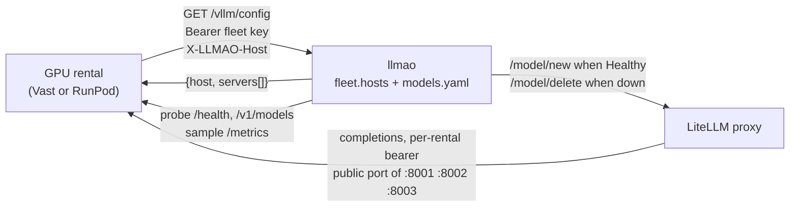
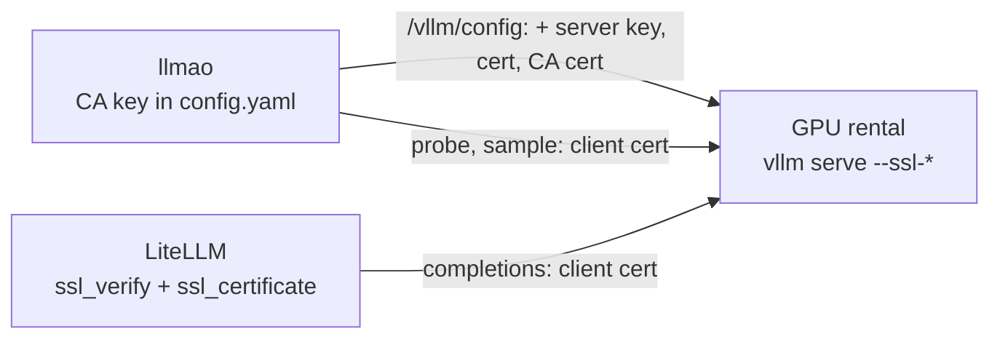

# How a GPU rental asks for its configuration

The contract between a GPU rental and llmao: the one request a rental makes at
boot, what it must present, and what it gets back. This is how the fleet
works today, not a proposal, with one exception: the last section,
[Transport security](#transport-security-mtls-to-the-rentals), is a design
that is not built. Rental boot on each provider is
[`../hosting/README.md`](../hosting/README.md); how the running fleet is
kept in step with LiteLLM is
[`fleet-reconcile-design.md`](fleet-reconcile-design.md).



llmao is the source of truth for which models exist, how each is served
(`models.yaml`), which rental serves what on which port (`fleet.hosts`), and
the bearer LiteLLM presents to each vLLM. The rental learns all of it from one
JSON response. There is no long-lived process manager on the rental: the
installer writes Supervisor units and exits.

## The request

```
GET /vllm/config
Authorization: Bearer <fleet.key>
X-LLMAO-Host: <the rental's name in fleet.hosts>
```

- **The fleet key** is the gate. `config.yaml` `fleet.key` is one shared
  secret, baked into every rental template and checked present at startup
  (`validate_fleet`, like the salt). Missing from the request: 403.
  Wrong, by a constant-time compare: 403.
- **The host** is the `fleet.hosts` key the answer is built for. When
  `X-LLMAO-Host` is present it is the only key: no fallback to the peer,
  and 404 if it is unknown. Vast instances reach llmao through a transparent
  proxy, so the TCP peer is not the instance and there is no
  `X-Forwarded-For`. Without the header, the peer is used -- which is the
  real caller, because hypercorn's `ProxyFixMiddleware` has already
  replaced the loopback `ProxyPass` hop with the address Apache appended
  to `X-Forwarded-For`. The header is read there and not here: the
  leftmost entry is the one a caller can send, so reading it would let a
  rental name itself by an address it does not have. The `X-LLMAO-Host`
  name is a claim, not a proof; the fleet key is what is checked.
- **Which name a rental sends** is the provider's business, set in that
  provider's `provision.sh` as `LLMAO_HOST`: the instance id on Vast
  (`CONTAINER_ID`), the pod id on RunPod (`RUNPOD_POD_ID`). `install_set.py`
  knows no provider's names. llmao only matches the name against the keys
  of `fleet.hosts`, and never dials it: a server's address is unknown
  until the provider's listing places it on a machine with an address,
  since the listing carries both the address and the name a rental on that
  machine sends. A row keyed by an address, as the legacy rentals and those
  provisioned before names were ids are, is its own address and still
  places by it. (The RunPod image has not yet run on a real pod.)
- **Every fetch is recorded by name** (first and last seen, a count; the
  `ProvisioningRecord` in `llmao/provisioning.py`, capped, oldest
  last-seen first), whether or not the name is intended, and logged with
  the claimed host and the peer. The record does not
  know membership: that is the fleet's join. A name nothing intends gets
  404 and shows in Work needed on `/admin` as "fleet key presented
  from a host not in `fleet.hosts`", with Approve.
- **The last fetch by an intended name is its loading start.** Each probe
  pass reads the record onto the name's servers: a rental that fetched its
  config and is not yet answering is Loading until `fleet.health_grace_s`
  has passed, then Stalled. The whole state machine is `rental-lifecycle.md`.

Rentals fetch `https://llm.apache.org/vllm/config` with default TLS
verification.

## The response

```json
{
  "host": "203.0.113.10",
  "servers": [
    {
      "name": "gemma4-26b",
      "model": "google/gemma-4-26b-it",
      "served_model_name": "gemma4-26b",
      "host": "203.0.113.10",
      "port": 8001,
      "api_key": "sk-vllm-...",
      "args": ["--reasoning-parser", "gemma"],
      "max_model_len": 32768,
      "vram_gb": 18,
      "disk_gb": 60
    }
  ]
}
```

One entry per vLLM process on the rental, joined from the host's `fleet.hosts`
rows and the `models.yaml` recipe each names.

- `name`: the process name, the row's third element when it has one, else
  the model name. Supervisor's program name and the log file name.
- `model`: the HF weights id (`model_info.vllm.model` in `models.yaml`).
  `served_model_name` is the name vLLM advertises on `/v1/models`.
- `port`: the **listen** port, what `vllm serve --port` binds. Never the
  public port a provider maps it to; the rental does not need to know that.
- `api_key`: the bearer this vLLM must require, derived as below. LiteLLM
  presents the same value, and so does llmao's sampler on `/metrics`:
  vLLM's own check covers only `/v1`, so the installer adds `RequireKey`
  (`--middleware`), which asks the same bearer of every path but `/health`.
- `args`: extra `vllm serve` arguments. A list of strings, or one string
  the installer splits.
- `gpu_memory_utilization`, `max_model_len`, `vram_gb`, `disk_gb`,
  `kv_bytes_per_token`: present only when the recipe sets them.
  `gpu_memory_utilization` is normally absent; the rental divides the card's
  memory between its servers from `vram_gb`. `vram_gb` and `disk_gb` are
  what the rental checks before pulling weights.

Beside `servers`, the payload may carry `hf_token`: the Hugging Face token
from `fleet.hf_token`, one for the rental rather than per server. The installer
sets it as `HF_TOKEN` in every program's environment. Absent when llmao has
none, and an installer that predates the field ignores it.

## Hosts and ports

A `fleet.hosts` entry is the rental's name (above) mapped to rows of
`[model_name, port]` or `[model_name, port, name]`. The port is the
container listen port, one of 8001, 8002 or 8003 (`VLLM_LISTEN_PORTS`;
a rental gets at most three), plus the handful of older pairs in
`LEGACY_SERVERS`. The optional name lets two processes share one
`models.yaml` row.

A provider publishes each listen port on some other public port. llmao
learns that mapping from the provider's listing (Vast's instance ports,
RunPod's `portMappings`) and uses it for everything that dials the rental:
the LiteLLM deployment's `api_base`, the health probe, the `/v1/models`
read and the metrics sampler. A fourth element on a host row, a public
port written by hand, is deprecated: it loads with a warning and only
seeds the port until the listing names the rental. Without a Vast key
configured the fleet is taken to be local and public equals listen; a
RunPod-only configuration reads as local too, which is a wart to fix when
one exists.

llmao owns placement. `models.yaml` says how to serve a model, not where.
Moving a model between rentals is a config change and a restart of llmao;
the rental templates are identical and never change.

### Three config lifetimes

| lifetime | what | to change it |
|---|---|---|
| **baked** | `FLEET_KEY`, `ASFQUART_URL` in the rental template | re-provision |
| **boot** | the assignment: model, port, launch args, `max_model_len` | the rental must re-fetch and restart vLLM |
| **live** | deployments, keys, budgets in LiteLLM | immediate |

Changing `max_model_len` in `models.yaml` does nothing on a rental until that
rental restarts vLLM, and nothing compares what llmao intends against what a
rental is running. A config revision reported back by the rental was designed
for that and is not built.

## The fleet key and the vLLM bearer

Two secrets, with different jobs.

**The fleet key** (`fleet.key`) is the one long-lived secret on a rental. One
value for every rental and every provider: that is what keeps the templates
identical and placement a control-plane matter. It gates `GET
/vllm/config` and nothing else. It does not mint a vLLM bearer.

**The vLLM bearer** is derived, not stored:

```
HMAC-SHA256(fleet.vllm_api_salt, "llmao.vllm.api_key\n" + host + "\n" + listen_port)
→ "sk-vllm-" + urlsafe-base64, no padding
```

`llmao/intent.py` is the derivation, run once when the rental's
`IntendedDeployment` is minted; `bin/llmao-vllm-api-key` computes one by
hand. The rental needs it before `vllm serve` and LiteLLM
needs the same value at `/model/new` after the rental is Healthy, so it has to
be computable on both sides from the host and listen port alone. llmao
keeps no key table and never reads the bearer back from LiteLLM, which
stores it encrypted. The salt lives only in llmao's `config.yaml` (Puppet
eyaml), never in a rental template, and is not rotated in place: a new salt
means a new bearer on every rental, a vLLM restart, and a new `/model/new`
each. Instance env injection was tried on Vast and does not work, which is
why the JSON is how a rental learns `--api-key`. The pairs in
`LEGACY_SERVERS` predate the salt and still run the shared
`fleet.selfhost_api_key`; `intent.vllm_api_key` picks the right one at
mint time, so the payload, the probe and LiteLLM all carry the same key.

**Who can mint.** The salt never leaves llmao, so a third party cannot
compute a bearer, including a rental that copied `FLEET_KEY`. Host and listen
port are still required inputs.

**Leaked host and port map.** A list of fleet hosts and listen ports can
leak (config, logs, the public Vast mapping). Accepted for today: the map
alone does not mint bearers, and membership is not hidden beyond the fleet
key on `GET /vllm/config`. Revisit if a leaked map should be insufficient
even for someone who also holds `FLEET_KEY`: that caller can claim
`X-LLMAO-Host` for each listed host and receive its derived key. Those
fetches are logged. Per-instance bootstrap tokens stay out of scope until
that revisit.

## Provisioning, in one paragraph

Both providers run the same installer, `hosting/install_set.py`, fetched
from this repository at boot. Vast runs it from a stock vLLM container via
`PROVISIONING_SCRIPT`; RunPod runs it from our own image, whose entrypoint
is its `provision.sh`. The installer sets `LLMAO_HOST`, fetches the JSON,
checks `vram_gb` and `disk_gb` against the rental, divides the card's memory
between the servers, writes one Supervisor program per server, and hands
over to supervisord, which runs `vllm serve` with the listen port, the
bearer and the arguments from the JSON. Restarts are Supervisor's. The
runbooks are [`../hosting/vast/README.md`](../hosting/vast/README.md) and
[`../hosting/runpod/README.md`](../hosting/runpod/README.md).

## Security

- The fleet key is the only long-lived secret a rental holds before it fetches
  its config; the Hugging Face token, when configured, arrives with it, in
  files only root reads. The vLLM bearer is derived from a salt the rental
  never sees.
- Membership is the durable gate. A rental's standing to fetch its config
  comes from `fleet.hosts` (in `config.yaml`, survives a restart) or from
  an admin's in-memory approval of a host that presented the fleet key.
  The *Approved* label itself never controls anything, so a recycled
  address cannot gain access from a lost or stale label. A new tenant on
  a previously onboarded address would still not hold the fleet key, and
  admins know the addresses of the rentals they expect. The residual risks
  are a leaked fleet key and a stale `fleet.hosts` row outliving its
  instance; the unlisted verdict in `rental-lifecycle.md` is the answer to
  the second.
- `GET /vllm/config` is served over HTTPS only.
- vLLM's `/health` takes no key; every other path on our rentals does
  (`RequireKey`, above). A passing probe says something answers at that
  address, not that it is ours; `/v1/models` with the bearer is the check
  that it is. A 401 makes the server Rejected (its deployment is
  deleted, the probe continues); Rejected on `REJECTED_PASSES` passes at an
  address no listing names is Foreign. See `rental-lifecycle.md`.
- Hardening that is possible without changing the rest: instance binding,
  short-lived bootstrap tokens, a signed token in place of the static fleet
  key. None is planned until the leaked-map revisit above.

## Transport security: mTLS to the rentals

**Design, not built.** Everything above this heading describes the running
fleet; this section describes what replaces its one unencrypted hop.

### The problem

Every hop from the gateway box to a rental is plain HTTP across the public
internet: the dial URL is `http://address:public_port` (`Rental.api_base`
in `llmao/fleet.py`), and LiteLLM's `api_base` is copied from it. Three
things cross in the clear:

1. the prompts and completions themselves, every request LiteLLM routes to
   a self-hosted model;
2. the per-rental vLLM bearer, in every LiteLLM request, every `/v1/models`
   probe and every `/metrics` sample;
3. the metrics.

Only `GET /vllm/config` is HTTPS today. The first item is the one that
matters: the portal tells users where their prompts are hosted, and the wire
to that host is readable by anyone on the path between an AWS box and a
rented GPU in someone's data centre. The second means a passive observer
holds a working bearer for a rental for as long as that rental lives.

Nothing authenticates the rental to llmao either. A passing `/health` says
something answers at the address; the bearer on `/v1/models` is the only
proof that it is ours.

### The design

Mutual TLS, terminated by vLLM itself, with one private certificate
authority that llmao owns. No reverse proxy, no agent, no overlay network on
the rental: the installer already builds the `vllm serve` argv from the
config JSON, and the JSON already carries a per-rental secret, so a server
certificate and key arrive the same way the bearer does.



**The CA.** One key pair, generated once by hand, the private key in the
eyaml beside the salt and never anywhere else; the public certificate in
hiera. It signs two kinds of certificate and nothing else.

**The rental's server certificate.** Minted by llmao at `GET /vllm/config`,
one per rental (not per server: the vLLM processes on a rental share the
address and so share the certificate). The response gains three fields
beside `servers`:

```json
{
  "host": "...",
  "servers": [...],
  "tls": {
    "key": "<PEM: the rental's private key>",
    "cert": "<PEM: its certificate, signed by the CA>",
    "ca": "<PEM: the CA certificate>"
  }
}
```

The key is generated on the portal and travels once, inside the HTTPS
response that already carries the bearer and the Hugging Face token; the
rental never makes a second request (no CSR round trip), which keeps the
one-request contract. The installer writes the three files under the data
directory, root-only, and adds to every program's argv:

```
--ssl-keyfile   <key>   --ssl-certfile <cert>
--ssl-ca-certs  <ca>    --ssl-cert-reqs 2
```

`--ssl-cert-reqs 2` is `ssl.CERT_REQUIRED`: a connection without a client
certificate signed by our CA fails in the handshake, on every path,
`/health` included. No `--enable-ssl-refresh`: a certificate lives as long
as its rental, and a rental that needs a new one re-provisions. The
certificate carries `extendedKeyUsage = serverAuth`, a `notBefore` an hour
in the past for a rental whose clock is behind, and a validity long enough
to outlive any rental we would keep (a year; the fleet turns over faster
than that, and a rental past its certificate's end goes Rejected and tells
us so).

**The SAN.** The certificate must name the address LiteLLM dials, as an IP
SAN, because `httpx` verifies the host in the URL against the certificate
and the URL host is the provider's public IP. The rental does not know its
public address or port, so llmao supplies it: at `GET /vllm/config` the
name is placed on an address through the provider listing, the same join
the fleet uses. When the listing has not placed the name yet (RunPod's
`publicIp` is empty while a pod initializes; a Vast listing may not have
been read since the instance started), llmao refreshes the listing once,
and if the name is still unplaced answers `503` with `Retry-After`; the
installer retries. An address change after mint is a re-provision, as a
change of assignment is today.

**The client certificate.** One, for the gateway box, minted once by hand
(`clientAuth`), long-lived, rotated with the CA. Stored in the eyaml as
cert plus key in one PEM, because that is the form LiteLLM takes, and
written by Puppet to `/opt/llmao/certs/litellm-client.pem`. LiteLLM
presents it through `litellm_settings.ssl_certificate`; llmao's probe and
sampler load the same file for their `httpx` client. vLLM checks only that
the chain ends at our CA, not the subject, which is enough: there is one
client.

**Trust on the gateway box.** `litellm_settings.ssl_verify` names one CA
file and that file replaces LiteLLM's default (certifi) outright, so it
must hold the public roots too or every paid provider breaks. The file is
`/opt/llmao/certs/ca-bundle.pem`: the OS bundle
(`/etc/ssl/certs/ca-certificates.crt`, which Infra keeps current) followed
by our CA certificate. A Puppet exec rebuilds it on every run, guarded by a
checksum compare so nothing happens when nothing changed, and notifies the
LiteLLM service: LiteLLM reads the file once, when its first client is
built, and caches the context for the life of the process. The OS trust
store is read and never written; everything we add lives under
`/opt/llmao`. certifi stops mattering, whatever version the venv pins.

**The dial URL** becomes `https://address:public_port`. The deployment key
in `llmao/reconcile.py` embeds a scheme too (`http://peer:listen_port`);
it is an identity, not a URL anyone dials, so it keeps its spelling and the
stamps in LiteLLM's `model_info` stay valid. Only the dialed base changes.

**The bearer stays.** The client certificate authenticates the gateway box;
the bearer authenticates the request to a particular vLLM. Two layers,
both cheap, and the `RequireKey` middleware is unchanged.

### What changes in the lifecycle

- The probe presents the client certificate on every path, `/health`
  included. "Something answers at this address" and "it is ours" collapse
  into the handshake: a server that completes it holds a certificate we
  minted. `/v1/models` with the bearer remains the check that the right
  models are served.
- A handshake failure is a new way to be Rejected, and a rental past its
  certificate's validity is one example. The verdicts in
  `rental-lifecycle.md` need a pass for this.
- The daily scanner that probes `/v1/models` with model names as tokens
  (issue #68) no longer reaches the middleware: it fails in the handshake.

### Rollout

A fleet-wide switch, not a mixed fleet. `fleet.tls: true` turns on the
mint, the `https` dial and the client certificate on the probe; every
rental is re-provisioned under it. llmao does not try `https` and fall
back to `http`, because a fallback is the attack.

### Considered and not chosen

- **An overlay network** (WireGuard, Tailscale) between the gateway box and
  the rentals. Needs a tun device the Vast containers do not offer, or a
  userspace stack, a second daemon on every rental, and a key per rental
  to manage. The traffic it would protect is the same traffic mTLS
  protects.
- **An SSH reverse tunnel from each rental.** No inbound port on the rental
  at all, which is attractive, but an sshd and a key per rental on the
  gateway box, one tunnel process per rental to keep alive, and LiteLLM
  dialing local ports that mean nothing in the listing.
- **RunPod's HTTPS proxy** (`https://<podId>-<listen>.proxy.runpod.net`).
  Already rejected for the fleet on other grounds: the proxy imposes its own
  request timeouts, and a model's first token can take longer than that
  under load, so completions would fail at the proxy before vLLM answered.
  It would also be RunPod only, terminated by RunPod rather than the
  rental, with no client authentication.
- **An `ssl.SSLContext` instead of the bundle file.** LiteLLM accepts one
  as `ssl_verify`, and llmao could build it in code from the OS defaults
  plus our CA plus the client chain, with no file to assemble. It would
  have to be set as an import side effect in the hooks module before
  LiteLLM builds its clients, and LiteLLM has had a regression in exactly
  that path (BerriAI/litellm#14396). Not a place for a security boundary.
- **Adding our CA to the OS trust store.** The cleanest bundle, with the OS
  package keeping it current, but it changes the box for every process on
  it. Everything llmao adds stays under `/opt/llmao`.
- **Pinning the CA and skipping the hostname check**, which would spare
  the SAN problem. Our own `httpx` client could do it; LiteLLM's could not
  without the `SSLContext` above.

### Open

- Where the Puppet exec that builds `ca-bundle.pem` lives in p6 and what it
  restarts; the LiteLLM restart drops in-flight requests, so an OS root
  update costs one interruption.
- Whether `cryptography` becomes a direct dependency of the portal (it is
  in the lock through LiteLLM) or the mint shells out to `openssl`.
- The exact `Retry-After` and how many retries the installer makes before
  it gives up and lets Supervisor's log say why.
